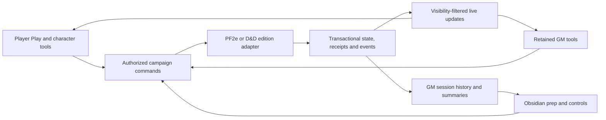

**Player-focused website implementation plan**

Prepared November 8, 2026. Approved by the user on November 8, 2026. Stage 0 review and task briefing are authorized; product implementation has not started. See [the Stage 0 index](README.md) for current execution status and new reuse findings.

The website becomes the place where players build, advance, equip, and play their characters. Obsidian remains the GM's preparation and control workspace. Both use the website's authoritative character and encounter state.

The first complete release includes Pathfinder 2e and D&D 5e, with explicit 2014/2024 campaign rules. It includes character creation and leveling, the integrated Play view, supported action automation, the full inventory/economy workflow, and Obsidian integration for both systems. Cosmere and Mistborn retain their existing tools and receive the new player experience afterward. Intermediate milestones below are implementation checkpoints; they do not move selected features out of the first release.

All 22 discovery answers are recorded in [the decision record](decisions.md). Code discovery used `origin/main` at `7aeb9549c1df2807935a4a44229284e13a5add1d`, subsequently verified against remote main during Stage 0. [Stage 0 evidence](baseline.md) supersedes stale queue labels and adds read-only production configuration/health observations; it does not claim production gameplay was tested.

**1. What the product will do**

| Area | Agreed behavior |
|---|---|
| Systems | PF2e and D&D together; D&D 2014 and 2024 selected explicitly per campaign. Preserve each system's mechanics. |
| Player control | Players manage their own characters within supported rules. The GM unlocks advancement and can make explained overrides. |
| Character building | Guided creation, resumable drafts, prerequisites, remaining choices, derived-stat previews, spell choices, archetypes/multiclassing, and GM-controlled retraining/respec. Preserve existing supported imports. |
| Access | Characters remain viewable and editable online between sessions, including while another campaign is live. Live encounter actions require the character's active session. |
| Main interface | Tablet/laptop Play view integrates personal combat controls with public initiative and encounter events. Phones get a compact companion view. |
| Automation | Resolve supported actions through target selection, rolls/saves, resource spending, damage/healing, effects, and duration handling. Explain changes and prompt for choices or rulings. Players can also add, adjust, and remove their own permitted conditions with validated values/durations and GM override. |
| Dice | Digital rolls and entered physical-dice results use the same resolution path. |
| Visibility | Players see their own full play information, party HP/conditions, and revealed enemies' names, rough health, and GM-revealed effects. Hidden enemies remain hidden. |
| Inventory | Persistent item instances, containers, carried/equipped state, investment/attunement, item effects, consumables, currency, and transfers. |
| Purchases | Players browse the campaign's allowed catalog and submit requests. The GM approves the item, quantity, availability, and price before fulfillment. |
| Crafting | Players manage projects; the GM advances campaign downtime. Supported prerequisites, checks, materials, costs, and completion rules are enforced. |
| Shared loot | Players request or reserve items. The GM or an explicitly appointed quartermaster finalizes distribution. |
| Obsidian | Preview structured room creatures and explicit starting effects, launch them together, and control PF2e or D&D encounters. Mirror live summaries and a complete session history into the vault. |
| GM tools | Keep the encounter tracker, encounter builder, rules lookup, and generators across all four games. Pause new website-wiki and VTT/map development; maintain existing functionality. |

The proposed navigation is **My Characters**, then character tabs for **Play**, **Character**, **Inventory**, and **Advancement**. Campaign tools expose **Party Loot**, **Purchases**, and **Crafting**. A character outside combat shows preparation/rest controls and an encounter status message; joining a live session opens the same character's Play tab. Existing accounts and assignments provide access.

On tablets and laptops, the Play view keeps personal HP/resources/conditions and available actions alongside initiative, pending saves/reactions, and recent events. Expandable explanations show why a total changed, where an effect came from, and when it ends. The phone companion keeps these essential controls reachable without requiring the full desktop layout. Immersion comes from clear turn context, portraits, action descriptions, visible consequences, and reduced bookkeeping.

**2. Architecture, delivery order, and verification**

Keep Flask/Jinja as the application shell. Existing rules implementations supply reusable behavior and regression baselines. For PF2e, reconcile the existing PR6/PR7 work and move supported build/action legality through the single versioned server rules boundary defined by the [rules-kernel ADR](https://github.com/etamd17/GM_pf2e/blob/7aeb9549c1df2807935a4a44229284e13a5add1d/docs/adr/0003-versioned-pf2e-rules-kernel.md). Its data-review scaffolding is not evidence that mechanics are already complete. D&D keeps its edition-aware rules modules. Modernize player surfaces incrementally using shared components and the established design tokens. Follow the repository's [progressive UI ADR](https://github.com/etamd17/GM_pf2e/blob/7aeb9549c1df2807935a4a44229284e13a5add1d/docs/adr/0004-progressive-ui-modernization.md) when extracting shared assets; inspect its implementation status before choosing the exact asset entry points. A frontend framework replacement is outside this plan.

The storage work follows the accepted [transactional-persistence ADR](https://github.com/etamd17/GM_pf2e/blob/7aeb9549c1df2807935a4a44229284e13a5add1d/docs/adr/0002-transactional-persistence.md): SQLAlchemy/PostgreSQL for mutable transactional state, SQLite for local/unit tests, and PostgreSQL integration tests for concurrency. Existing identity/draft infrastructure is reusable. Current code still keeps character payloads and encounter state in files; complete game-state transactions and a durable event outbox remain implementation work. Production backend settings and readiness must be verified before cutover.

Five boundaries guide implementation:

- **Character state:** campaign-scoped stable IDs, independent build decisions and live resources, persisted item/effect instances, and explicit revisions. A builder save must preserve intervening damage or resource use. PF2e access must stop depending on the active party cache before its live-campaign restriction is removed.
- **Commands:** all player, GM, and plugin mutations use the same services. Each request carries a stable operation ID and expected revisions; authorization is checked again when committing. PF2e and D&D retain separate rules adapters.
- **Pending actions:** choices, saves, reactions, and physical rolls are resumable operation stages. Do not hold a database transaction open while waiting for a person. Validate targets and current state again at resolution; each committed stage records its effects once.
- **Events:** commit state changes, command receipts, and gameplay events together. Publish live updates and Obsidian history from a durable outbox. Replay can repeat delivery, so consumers deduplicate by event ID. Include website actions, automatic consequences, manual adjustments, corrections, approvals, loot, and crafting.
- **Projections:** produce owner, party, player-encounter, and GM views on the server. Full GM records never reach player responses, streams, or replay. The Obsidian mirror is GM-scoped and lives separately from authored notes.

Recommended implementation sequence:

| Milestone | Concrete deliverable | Required exit evidence |
|---|---|---|
| **P0: reconcile and define contracts** | Establish the current main baseline and deployment/backend settings; inventory overlapping work, including PF2e PR6/PR7 rules work; freeze the initial supported-content matrix; define IDs, permissions, command/result contracts, and three representative system fixtures. | Written task briefs, migration inventory, agreed UI mockups, and coverage matrix for PF2e, D&D 2014, and D&D 2024. |
| **P1: character access and durable state** | Campaign-scoped character reads/writes, common identity integration for D&D, persistent build/play and encounter state, receipts and event outbox; preserve imports and legacy identities. Include enemies, turns, and encounter effects in the transaction boundary. | Campaign A characters can be edited while B stays live; ownership, characters, encounter state and events survive migration, conflicting saves, and restart together. |
| **P2: shared actions and effects** | A shared resolution workflow backed by system adapters, physical/digital dice, durations, pending saves/reactions, explanations, and GM corrections. | Equivalent supported actions from player, GM, and plugin command paths produce the same result; retries cannot spend or apply effects twice. |
| **P3: guided character lifecycle** | Private resumable creation/import/level-up drafts, full supported choices and validation, stat previews, GM advancement unlocks, and retraining controls. | The complete lifecycle passes for all three rules profiles; saved stats match previews and play resources remain correct. |
| **P4: inventory and economy** | Persistent gear/containers/equipment effects, accepted transfers, catalog purchase approvals, crafting projects/downtime, and reserved party loot. | Concurrent approvals/claims/transfers remain consistent; invalid requests cannot mint items, duplicate currency, or bypass designated authority. |
| **P5: integrated player experience** | Tablet/laptop Play, character/inventory/advancement journeys, compact phone companion, party visibility, pending work, and reconnect feedback. | Browser journeys work with several players plus GM; hidden information is absent from network data and essential controls work by touch and keyboard. |
| **P6: Obsidian workflow and history** | Both systems' room preview/launch, starting effects, command parity, pending GM approvals, compact live summaries, and replayable all-origin history. | Previewed roster/effects launch together once; reconnect and plugin restart produce one logical history without overwriting authored notes. |
| **P7: rehearsal and release** | Migrated staging copy, three complete game rehearsals, compatibility checks, rollout flags, current-state export and rollback rehearsal. | All first-release acceptance journeys pass; reviewed migration/deployment evidence and a recoverable release are ready. |

This is dependency order, not a requirement to finish every screen sequentially. UI mockups and browser prototypes can proceed during P1. After the command and state contracts stabilize, advancement and economy can run in parallel. Obsidian transport changes can start after P1/P2, while full verification waits for economy and player events. Every milestone covers PF2e and both D&D editions; first-release parity is checked continuously.

**P0 must settle scope precisely.** Inventory the installed, verified rules content and preserve current supported feature coverage. For each build option, item effect, action family, spell family, and crafting rule, record whether it is fully automated, requires a named choice/ruling, or is unsupported. Unsupported/custom content gets an explicit manual GM path. Do not pass the release by silently relabeling previously promised automation as unsupported. Pin system, edition, and content version to characters and encounters; changing a campaign's edition requires an explicit conversion workflow rather than reinterpretation of saved characters.

Because new VTT work is paused, action automation uses selected targets and explicit physical-table inputs for range, cover, positioning, and area membership where needed. The GM supplies these facts or resolves ambiguity. Building a new spatial simulation is not a dependency of this release.

**P1 migration includes recovery.** Inventory and back up characters, owners, drafts, HP/resources, ongoing effects, gear, and active encounter state. Rehearse additive import with count/checksum reports; backfill stable item IDs without merging distinct same-name gear. Report unresolved container references and identities. PF2e investment currently stored only in a browser cannot be recovered from a server backup: offer an explicit review/import from that browser or ask the player to confirm the investment state during migration.

Keep build revisions separate from ordinary combat revisions where possible. Publishing a changed build revalidates against current state and presents any necessary HP/resource reconciliation. Anytime online editing does not imply offline mutation queues or several simultaneous live encounters. Preserve the existing single-worker deployment until its process-global state and event delivery dependencies are actually removed.

**P2 effects are first-class records.** Record source, owner, targets, stacking rules, duration basis, start/expiry trigger, and applicable modifiers. Encounter turns, elapsed in-world time, and GM-advanced downtime are explicit clocks; a browser disconnect does not advance them. Compute totals on the server and explain the result in the UI. Own-character controls support applying, changing, and removing permitted conditions, including values and durations. Physical dice entry distinguishes raw dice from totals when natural values matter. Retain rolls and pending choices across reconnect. Spend or reserve resources at the rule-defined stage, with explicit cancellation behavior after commitment. Define who can submit each save/reaction, when its window closes, and how the GM resumes or adjudicates disconnected/invalidated targets; disconnect never silently chooses a roll or outcome. Show which consequences a correction reverses; record corrections as new events instead of erasing history or claiming every action has a perfect undo.

**P3 completion includes useful failures.** A blocked choice explains the unmet prerequisite. Drafts show saved/pending/conflict status, preserve unfinished input, and resume across devices. Level-up cannot publish before the GM's unlock. Retraining/respec checks the resulting complete build and records the GM's authorization. Import previews identify mismatches without silently overwriting an existing character or assigning ownership by name.

**P4 uses explicit transactions and permissions.** Purchase requests move from submitted to approved-and-fulfilled, rejected, or cancelled. Persistent shop records retain GM-managed availability, any limited stock, and pricing. Players can request from a shop or the allowed general catalog through the same workflow. The GM approves an exact quote; approval rechecks funds and any stock, then fulfills payment, stock adjustment, and item grant together. Unattended purchases are not the selected policy. A changed quote remains visible in the request history.

Crafting projects track recipes, prerequisites, materials, costs, required checks, and progress against a GM-controlled campaign clock. Advancing downtime has a retry-safe ID; each project applies the advance once. Edition/system adapters determine progress and cost rules. Unsupported recipes require an explicit GM resolution. Pausing or cancelling a project follows its rules and records any returned resources.

Shared loot uses item IDs, reservations, and explicit finalization. Reservations do not add the item to a character's usable inventory. Only the GM or campaign-appointed quartermaster finalizes distribution; quartermaster permission grants no character-editing, rules-override, shop-approval, or hidden-encounter access. Direct player-to-player transfers require acceptance and preserve item state; a locked pending transfer cannot also be spent, equipped, or sent again. Currency splits and awards use the same ledger and cannot exceed the available pool. Item identification and unrevealed properties respect GM visibility.

**P6 keeps Obsidian as a client.** Structured room manifests identify the system/rules context, creatures/counts, and explicit starting effects. Preview resolves every reference and binds a digest/revision to the launch request. An unknown creature, invalid effect, changed note, or stale preview produces a useful error and leaves the current encounter intact. Confirm before replacing an active encounter. Launch commits the validated roster and effects together.

Plugin capabilities negotiate protocol/system support so incompatible client/server versions fail clearly. Commands delegate to the website services; the plugin does not implement a second rules engine. Surface GM purchase requests, advancement unlocks, loot requests, and downtime controls through a small approvals/control pane backed by the same endpoints as the website. Keep both interfaces consistent.

Live mirror files contain concise character/encounter summaries; details load on demand. History records actor, source client, campaign/session, system/edition, action/event IDs, dice source, targets, revisions, applied changes, and causal links. Snapshots carry a consistent event/revision watermark; subscribe/replay after that watermark so updates between snapshot retrieval and subscription cannot disappear. Recheck campaign and permissions on resubscription. Use campaign-scoped replay cursors, event-ID deduplication, paginated catch-up, and visible reconnect status. A stopped plugin catches up later. Generated files never overwrite GM-authored notes; rotating local logs must preserve the ability to rebuild complete session records from durable history.

The following file groups are the proposed implementation boundaries. Paths are repository-relative design locations; new files are proposals, not claims that they already exist.

| Concern | Reuse or adapt | Proposed additions |
|---|---|---|
| Persistence and access | `core/persistence/`, `core/character_workflows/`, `core/route_policy.py`, `core/request_context.py` | Character/encounter-state and command/event repositories, SQL migrations, migration/reconciliation/export tools; D&D ownership/draft adapter. |
| Rules and actions | `systems/pf2e/rules/`, `services/active_effects.py`, `services/session_ops_rolls.py`, PF2e handlers in `app.py`, `systems/dnd5e/service.py`, `systems/dnd5e/combat.py`, `systems/dnd5e/rules/` | `services/action_resolution.py`, `services/session_events.py`, thin PF2e/D&D command adapters. Reconcile PR6/PR7 kernel work; extract existing behavior before adding mechanics. |
| Inventory and economy | Existing PF2e inventory/loot handlers; D&D inventory service and IDs | `core/inventory/`, `core/economy/`, `services/inventory.py`, `services/economy.py`; transactional requests, reservations, projects, and ledger. |
| Advancement | `core/character_workflows/`, `services/character_workflows.py`, existing builders and levelers | Shared advancement permissions/contracts and system-specific draft adapters; extend common workflows to D&D. |
| Player UI | `templates/player_sheet.html`, `templates/player_levelup.html`, `templates/player_view.html`, `templates/_pc_sheet/`, existing D&D templates, `static/js/dnd5e.js`, `_sse_hub.html` | Shared player layout/components, Play entry point, inventory/economy/advancement modules; use the verified asset pipeline from P0. |
| Obsidian | `services/obsidian_sync.py`, `core/obsidian_sync.py`, `tools/obsidian-plugin/main.js` | `services/encounter_import.py`, versioned manifest schema, capability negotiation, campaign replay cursors and mirror deduplication. |
| Verification and coordination | Existing character-workflow, rules, persistence, Obsidian and browser suites; `docs/handoff/` | Focused tests beside existing suites; one scoped brief/report per implementation task and a player-release acceptance matrix. |

No module should become a second state store or rules engine. Character, inventory, action, and economy services share repositories and operation IDs; adapters translate existing system behavior into those contracts.

For coordination, retain the established handoff workflow: Claude owns the high-risk state/rules/sync implementation and design briefs; Codex reviews those changes and handles bounded UI/mechanical tasks where assigned. Use one integration baseline and one worktree per task, with explicit shared-file ownership. Do not build against the older dirty `GM_pf2e` working branch or overwrite unfinished work.

| Existing work | Treatment after plan approval |
|---|---|
| PF2e builder/leveler work, including UI-11 | Inspect and reuse completed changes; fold remaining work into P3 rather than build a competing implementation. |
| D&D ownership/private drafts, 5E-03/5E-05 | Promote to P1/P3 dependencies because the new release needs coherent access and resumable workflows. |
| Design-system work | Keep useful tokens, focus, motion/accessibility and player-screen work; prioritize changes that support this release. |
| Website wiki and VTT/map rebuild | Park new implementation; preserve branches, artifacts and handoffs. Fix defects in existing shipped features as needed. |
| Cosmere/Mistborn expansion and remaining GM UI work | Preserve existing capabilities; defer the new player experience and unrelated expansion until this release is complete. |
| Encounter tracker/builder, lookup, generators | Maintain all four systems and integrate shared state changes without removing these tools. |

The first implementation task is **P0: reconcile the baseline and write bounded contracts/briefs**. Update the shared queue and relevant handoffs with this direction before assigning new builds. This planning task has not sent messages to other chats or modified their work.

Release acceptance is a set of complete journeys, not a count of passing unit tests:

| Journey | Required result |
|---|---|
| Between-session character work | While B is live, an owner in A resumes a draft, edits gear, and prepares advancement. B remains untouched. Ownership changes immediately restrict subsequent requests. |
| Build and level | For PF2e, D&D 2014, and D&D 2024: create/import, save incomplete choices, resume, publish, unlock advancement, choose supported advanced options, and perform authorized retraining. Invalid direct API requests fail. |
| Concurrent play/editing | GM damage and a player's build/inventory save both survive; stale edits show a recoverable conflict rather than overwriting newer state. |
| Room to combat | Preview room creatures/effects in Obsidian, launch once, see the permitted player roster, resolve supported actions with both dice methods, process pending saves/reactions and duration events, then close the encounter. |
| Resource and effect correctness | Action costs, HP, derived stats and effect lifetimes agree across the sheet, GM tracker and plugin. Test player-applied conditions, pending/cancelled actions, reaction windows, disconnects, and invalidated targets. Duplicate requests and restart do not reapply costs or effects. |
| Purchases and loot | An unapproved request grants nothing. A valid approval debits/grants once. Two competing reservations cannot award one item twice; only GM/quartermaster can finalize. |
| Crafting and gear | GM downtime advances a valid project once; checks/costs/output follow its rules. Container/equipment/investment state survives switching devices and changes derived stats correctly. |
| Privacy | Hidden actors, exact enemy HP, unrevealed effects, secret rolls and private notes are absent from unauthorized HTTP, event-stream, and replay payloads. |
| History and recovery | Website/player/plugin actions and automatic consequences reach the vault. Interrupt server responses and plugin cursor writes; inject an update between snapshot retrieval and subscription and a role change before replay. Recovery yields one logical result and a complete permitted history. |
| Usability and compatibility | Tablet/laptop touch and keyboard flows, compact phone controls, existing retained GM tools, and existing Cosmere/Mistborn functionality pass representative browser checks. |

Use the existing snapshot/ground-truth, D&D service/effect/combat, character-workflow, persistence, and Obsidian contract/behavior suites as regression anchors. Add failure-injection and PostgreSQL concurrency tests where operations cross characters, money, items, encounters, or events. Run template parsing for HTML changes, focused browser journeys for each changed surface, and full required CI before release. Tests are planned here; none were run as part of drafting this document.

Roll out through isolated migration rehearsal and campaign-scoped flags. Verify backup restoration and export of the latest authoritative state. A rollback after new writes must export or restore compatible current state; switching back to stale JSON files would lose changes. Keep live players on the stable path until the migration and complete three-profile rehearsal are accepted. Dates should be estimated after P0 measures actual reusable work and coverage gaps; this scope is a multi-milestone release.

**3. The three likeliest failure points**

| Risk | What could go wrong | Planned control |
|---|---|---|
| Split character state during migration | Cached live values, files, database records and browser-only inventory settings disagree; build saves overwrite combat changes. | Campaign-scoped repositories, separate build/play revisions, stable IDs, migration reconciliation, explicit browser-state recovery, and restart/concurrency tests before access restrictions are lifted. |
| Overpromising automatic rules | Different editions, complex spell/action chains and physical-table facts produce incorrect results or unexplained exceptions. | Frozen coverage matrix, system/edition adapters, authoritative derivation, explicit choice/ruling stages, explained effects, and representative plus per-feature rules fixtures. |
| Multi-step operations duplicate or leak data | Retried purchases, room launches or action results apply twice; incomplete history or player projections expose GM details. | Atomic state/receipt/event commits, durable outbox, deduped replay, role-scoped projections, and fault-injection tests covering server and plugin interruptions. |

**4. Review and next step**

The product decisions are approved. Stage 0 has produced the baseline and task package linked in [the index](README.md). State contracts, verified coverage and player mockups remain explicit Stage 0 tasks before dependent product work becomes ready. The documentation branch records the new queue priorities; original worktrees, live settings and running chats remain untouched.
