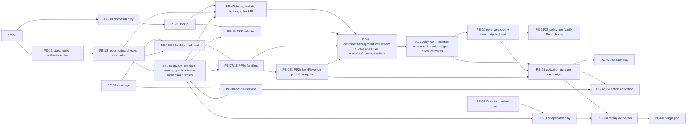

# Player release: state, command and authority contract (PE-01)

**Status:** accepted (Codex, round 4, 2026-11-09; merged in PR #247). Review history is in
[PE-01](../handoff/tasks/PE-01-state-command-contract.md). Changing a rule still needs a
revision and a new review (see below).
**Base:** `origin/main` `d08085b0` (PR #243). Source anchors are symbols on that commit, linked
rather than copied.

**Rules for this document.**
- "Must" binds every later task.
- A task that needs a different rule revises this file and gets it reviewed again (task-map
  rule). It does not create a second protocol.

**Scope.** PF2e and D&D 2014/2024 state for the player release. Cosmere and Mistborn keep their
current paths and adopt this contract later; nothing here may break them. None of this is
implemented yet.

## 1. Identifiers and rules pins

| ID | Format | Source | Notes |
|---|---|---|---|
| `campaign_id` | `[0-9a-f]{32}` | existing stores | `core/request_context.py::CampaignContext` |
| `character_id` | existing: ≤ 64 chars `[A-Za-z0-9_-]`; new: 32-hex | SQL `characters.id` (`ownership.register_character` keeps `doc.id` when it is ≤ 64 chars) | D&D: equals the file `pid` (`store.py::pc_path`). PF2e/Cosmere: the SQL id; the filename is only the locator. Never a display name. The dry run reports nonconforming ids. |
| `item_id` | 32-hex (uuid4, globally unique) | server, on create/split/migration | D&D 12-hex `uid` is kept read-only as nullable `legacy_uid`; the D&D index keys `i{idx}` (`rules/character.py`, `routes.py`) are remapped. PE-40's backfill moves D&D `resources_used["item:<uid>"]` / `["item:i{idx}"]` into the matching item's `charges`. A PF2e stored entry gets one id each; same-name entries are never merged. PF2e shield fields (`shield_hp`, `shield_max_hp`, `shield_hardness`, `shield_bt`, `shield_ac_bonus`, `shield_name`) attach to the item for the first worn `build.armor` entry with `prof: shield`, the one `Character.__init__` selects; if there is none and any of those fields is set, the backfill mints a shield item named from `shield_name` (or "Shield") holding them, and the dry run lists it; if neither exists there is no shield item, and in db authority `shield_block`, `repair_shield` and `toggle_shield` refuse with `422 rule_violation` ("no shield"), a listed change from today's default 20-HP shield. Export writes the shield fields back to the build from that item. Restore mints new ids. |
| `effect_id`, `encounter_id`, `combatant_id`, `action_id`, `prompt_id`, `event_id`, `advance_id` | 32-hex | server | D&D `cid` already matches the `combatant_id` format and is kept. PF2e/Obsidian `instance_id` becomes `legacy_ref`. `action_id` is server-minted; the row stores the initiating `operation_id`. |
| `session_id` | new: `[a-z0-9][a-z0-9_-]{7,99}`, never truncated | GM session start (section 4) | Unique for the campaign's lifetime (section 4, Sessions). Today `start_session` accepts any string ≤ 120, the v0.9 plugin truncates folder names at 100, and main's `safeSegment` rewrites `:` and other characters (PE-03 F4). The new form is lowercase and filesystem-safe, so the plugin's folder name is the id itself, unchanged. Existing ids stay valid as history, and the dry run reports any that are not in the new form. |
| `operation_id` | `[A-Za-z0-9_-]{16,128}` | client, once per attempt (section 3) | The legacy Obsidian `command_id` (`COMMAND_ID_RE`) stays on the legacy route until PE-60. |
| `seq` | int64 > 0, contiguous per campaign | allocated under the stream lock | Replay cursor and order. **A seq is not a revision.** |
| `stream_epoch` | int ≥ 1, monotonic per campaign, never reset | `campaign_state_authority` row | Bumped whenever authority becomes `db` or `file` (including abort), on entering `exporting`, and on campaign-archive restore (PR4B). Not bumped on `file → migrating`. |

**Rules profile.** The campaign's pin lives in SQL `campaigns.settings.rules`
(`{profile, content}`). Characters and encounters copy it when created, and every command must
match it.

| `rules_profile` | Legacy value | `content` pin |
|---|---|---|
| `pf2e` | n/a | `{"ruleset_id", "manifest_sha256"}` (ADR-0003). Existing records use `pf2e-legacy-unknown` with `manifest_sha256: null` until PE-36. |
| `dnd5e-2014` | `edition: "classic"` | `{"data_version": <installed VERSION>, "db_sha256"}`. The data itself stays off Git. |
| `dnd5e-2024` | `edition: "one"` | same |

- **Content changes.** When the installed content stops matching a pin, commands that derive
  rules fail with `503 content_mismatch`; reads still work. The GM command
  `campaign.repin_content` revalidates every character, reports failures, and writes the new pin
  with an event. The admin data page lists the campaigns that need it.
- **D&D edition default.** A D&D campaign with no explicit edition defaults to `one` today
  (`systems/dnd5e/routes.py::edition`). The dry run reports it as `implicit_default` and the GM
  must confirm it.
- **Edition mismatch.** A character whose `build.edition` differs from the campaign gets
  `422 edition_mismatch` until an explicit conversion runs. A saved character is never
  reinterpreted under another edition.
- **System strings** are exactly `pf2e`, `dnd5e` and `cosmere`.
- **D&D locator (PE-10/11).**
  - `legacy_storage = "dnd5e_characters"` and `legacy_file = "<pid>.json"`, with
    `legacy_file == id + ".json"`.
  - The path must be exactly `campaigns/<cid>/dnd5e/characters/<pid>.json`.
  - These rules hold for every row, archived or not. Archive never rewrites a locator, in
    either system; it only sets `archived_at`, which removes the row from locator uniqueness
    and every locator lookup (section 7).

## 2. State records, revisions and conflicts

| Record | Key | Contents | Revision |
|---|---|---|---|
| `character_states` domain `build` | `(campaign_id, character_id, 'build')` | Ancestry/species, class levels, choices, feats, spells known, ability method, name, public details and portrait. D&D `build` + `details` (`service.py::BUILD_KEYS`); PF2e Pathbuilder build minus equipment. | `build` rev; replaces D&D `build_rev` |
| `character_states` domain `play` | `(campaign_id, character_id, 'play')` | HP/temp HP, conditions, owned effects, death saves, resource/slot/focus/hero-point usage **plus reservations**, prepared spells, inspiration, owner-private notes | `play` rev |
| `item_instances` (PE-40) | `item_id` | Holder (`character`/`stash`/`shop`), container (`null` = the holder's top-level "root"), qty, equipped/invested/attuned, charges, revealed and unrevealed properties, notes, `lock`, `self_reported` | per item |
| `wallets` + `ledger_lines` (PE-40) | `(campaign_id, holder)` | Coin counts per system denomination (D&D cp/sp/ep/gp/pp, PF2e cp/sp/gp/pp), plus `held_cp` and `unconfirmed_cp`. Each balance change appends a ledger line in the same transaction. | per wallet |
| campaign clocks | `(campaign_id, clock)` for `world`, `downtime` | Value and revision | per clock |
| `encounter_states` | `(campaign_id, encounter_id)` | Status, round/turn, initiative order, creature vitals and effects, rules pins, clock anchors | encounter rev |
| `encounter_combatants` | `(campaign_id, encounter_id, combatant_id)` | `kind`, `character_id` (composite FK to `characters(campaign_id, id)`, so a PC cannot come from another campaign), creature ref | via encounter rev |

- **PC vitals live in one place.** The encounter never copies PC vitals; they stay in the PC's
  `play` row, as `service.py::_vitals_getter` does today. Damage to a PC therefore bumps that
  PC's `play` revision and leaves the encounter revision alone.
- **Derivation inputs.** Derived stats are computed from `build`, `play` and equipped items.
- **Drafts** stay in `character_drafts` / `CharacterWorkflowReceipt`
  (`core/persistence/models.py`). Saving a draft never bumps `build`. In db authority, *publish*
  is one command: it writes the `build` row, the command receipt and the events, then marks the
  draft published. In file authority the existing workflow receipt stays in use.

```json
{"campaign_id": "a1...", "character_id": "c7...", "domain": "play", "schema_version": 1,
 "revision": 21, "rules_profile": "dnd5e-2024", "content": {"data_version": "2026.10", "db_sha256": "9f..."},
 "payload": {"hp": 24, "temp_hp": 0, "conditions": {}, "slots_used": {"1": 1}, "reserved": {}, "effects": []}}
```

**Checks before a command applies.** A command lists the revisions it relies on in `expected`, as
`{kind, id, rev}` entries. Every command type names one **subject** record, and checks 5 and 6
apply to that record. A create command names its parent as the subject: the campaign for
`session.start`, the buyer character for a purchase submit, the actor combatant for
`action.declare`. Each command type also declares its **dependency set**: the record kinds it
may list in `expected`, and how each relates to the subject. For example, `apply_damage` on
character X may expect only `character.play:X`; a loot finalize may expect the stash item plus
the requests it names. The type's payload schema also declares which payload fields are record
ids (targets, recipient, container, shop, request ids).

The server checks, in this fixed order; the first failure answers. Steps 2–9 run inside the
command transaction, under the stream lock.
1. **Envelope** is well formed, and every `expected` kind is in the type's dependency set
   (`400 bad_envelope`). This depends only on the static schema, so it reveals nothing.
2. **Authority fence.** The campaign is in `db` authority (`503 migration_in_progress` or
   `authority_unavailable`) and the envelope `epoch` equals the current `stream_epoch`
   (`409 resync_required`). This runs **before** the receipt lookup, so an old-epoch retry never
   replays.
3. **Receipt** (section 3).
4. **Role.** The caller's campaign-level role allows this command type (`403 not_permitted`).
5. **Visibility, then subject role.**
   - The subject, **every** `expected` reference and every record id declared in the payload
     exist, belong to this campaign and are visible to the caller; each `expected` reference also
     matches its declared relation to the subject (`404 not_found`). Hidden, missing and
     wrong-relation references give the same answer, so neither ids nor revisions can be probed;
     no revision is compared before this passes. A principal's visibility is the union of the
     projections of every role it holds (section 6).
   - Only once visibility passes: the caller's role on the subject (owner, editor, viewer, party,
     QM or token scope, per the section 8 matrix) must allow this command type
     (`403 not_permitted`, nothing written). A subject the caller cannot see therefore always
     answers 404, never 403.
6. **Terminal.** The subject is not terminal *for this command* (`409 already_finalized`). For
   `action.correct` the subject is the stage, and the stage counts as terminal once corrected.
   For `session.start`, an existing session row with the requested id makes the command terminal.
7. **Revisions.** Every `expected` entry still matches (`409 stale_revision`).
8. **Pins:**
   - `409 rules_mismatch`: the request's `rules` differs from the campaign pin;
   - `503 content_mismatch`: the installed content differs from the pin;
   - `422 edition_mismatch`: the character's pin differs from the campaign's.
9. **Rules and grants** allow it (`422`), including `unlock_required`, `in_encounter` and
   `target_invalid`. Targets reach this check only after passing check 5, so `target_invalid`
   only ever names a target the caller can see.

`expected` is required for:
- build saves and publishes;
- whole-list replacements;
- economy finalizations (the request, stash item or project row);
- clock advances (the clock row);
- whole-action commands (section 5).

**Override.** The envelope field `"override": {"reason": "..."}` is accepted only from the GM
(or a token scoped for it), and is recorded on the event. It bypasses only adapter validations
marked overridable, such as `in_encounter` and a rules legality check. It never bypasses checks
1–8, authorization, the reservation rule below, or the economy invariants in section 9.

An input to a pending action instead expects `{kind: "prompt", id, status: "open"}`, so
simultaneous saves against one action do not conflict. Intent commands (damage, heal, a
condition, spending a resource) treat `expected` as optional; the server validates them against
current state under lock.

```json
{"ok": false, "code": "stale_revision", "operation_id": "op-...",
 "conflicts": [{"kind": "character.build", "id": "c7...", "expected": 4, "current": 5}],
 "current": {"...": "caller's projection of the conflicting rows"}}
```

**Schema versions.** A reader upgrades older payloads in code and writes the upgrade back only
within a command. An unknown newer version fails closed with `503 authority_unavailable`.

**Lock order.** Every command transaction takes its locks in this order:
1. the campaign stream row;
2. the encounter;
3. action rows;
4. `character_states` rows, in ascending `(character_id, domain)` order;
5. items, wallets, shop, stash and project rows, in ascending id order;
6. then it inserts the receipt and events.

The stream lock is held until commit and is never narrowed: `seq` allocation and the snapshot
watermark depend on it. In file authority today's order stays as it is: D&D takes the encounter
before the PC (`store.py` docstring), and PF2e takes `_pc_spell_lock` before `ENCOUNTER_LOCK`.

**Max-HP reconciliation** is an adapter hook. It runs in the same transaction as any build
publish, item change or effect change that moves effective max HP, and appears in the result as
`result.reconciliation[]`. Let `effmax` be the system's effective maximum
(`combat.py::effective_max` for D&D; PF2e includes drained).
- **Not triggers.** A condition or play field that changes `effmax` and carries its own HP rule
  (PF2e drained gain and recovery, D&D `max_hp_reduction`) is applied by its own command under
  that system rule, and the hook does not run for it. A trigger computes `effmax` before and
  after with those values held constant.

The HP rule keys on the HP value, never on a condition. The `play` row stores a non-negative
`hp_floor_debt` (default 0), so that a fall and a later rise of the maximum cancel exactly:
- **Dead** (the system's dead state): nothing changes.
- **`hp == 0`:** HP stays 0 and the debt is cleared. The dying or unconscious-from-dying state is
  untouched; PF2e dying and D&D death saves only exist at 0 HP.
- **`hp > 0`:** let `raw = hp + (effmax' - effmax) - hp_floor_debt`. If `raw ≥ 1`, then
  `hp' = min(raw, effmax')` and the debt becomes 0. Otherwise `hp' = 1` and the debt becomes
  `1 - raw`. This holds whatever conditions apply: an unconscious condition from another source
  (D&D keeps the source separately, `systems/dnd5e/combat.py` at the base) keeps its HP and the
  condition. Damage already taken stays counted whether the maximum rises or falls, so
  unequipping and re-equipping can never heal. Example: 3/45 falls to max 37 → 1 HP, debt 6;
  rising back to 45 → 3 HP, debt 0.
- **Healing** changes `hp` only. The debt is cleared when HP reaches 0 or a rest sets HP to the
  maximum.
- **Behaviour change.** Today D&D only caps HP when the maximum falls. The rule above also
  subtracts, so a temporary fall cannot be used to bank HP. This is deliberate and needs no data
  migration (existing rows start with debt 0).
- **Temp HP** is unchanged.

**Pools and reservations** (resource charges, slots, focus and similar):
- **Used counts on a pool with no reservations** clamp to a lowered maximum; the result lists
  each clamp.
- **A reservation is never truncated in place.** A user-initiated write that would lower a
  pool's maximum below `used + reserved` while the pool has at least one reservation, or remove a
  pool that has a reservation, is refused with
  `422 rule_violation` naming the blocking actions. This covers publishing, equip/unequip, item
  removal, rest and manual adjustment. The GM can resolve or cancel those actions first;
  `override` does not bypass this.
- **An automatic change** is one the server derives as a consequence of another command, not
  that command's own direct write to the pool: an effect expiring when its clock advances, or the
  committed result of an action stage. It cannot be refused. In the same transaction, the pool's
  reservations are released **newest first** (by the owning action's declare `seq`) until
  `used + reserved ≤ max'`, or all of them if the pool is gone. If `used` alone still exceeds the
  new maximum, it then clamps. Each released action's affected targets go to `held` with reason
  `reservation_invalidated`, and the event and the preview list them in that order. The GM then
  resolves them.
- **A removed pool with no reservations** is dropped, its used count is listed, and an effect
  that depended on it ends with an event.
- **Effects** whose source is gone end, with an event.
- **Choices** that are no longer valid become `choice` prompts stored in `play` (`origin:
  reconciliation`). They never block the publish and are never silently removed.
- **Combatants:** publishing a build while the character is a combatant in an active encounter
  gets `422 in_encounter`. The GM may override.
- **Preview** returns exactly the list that the commit will apply.

## 3. Command envelopes

The request body (db authority) for every player, GM, tracker and Obsidian mutation:

```json
{"schema": 1, "operation_id": "op-3f9c2e7a1b5d4c60", "campaign_id": "a1...", "epoch": 1,
 "type": "character.play.apply_damage", "subject": {"character_id": "c7..."},
 "expected": [], "rules": {"profile": "dnd5e-2024"}, "payload": {"amount": 7, "damage_type": "fire"},
 "client": {"origin": "website", "app_version": "...", "sent_at": "..."}}
```

- **Principals.** The principal is taken from the authenticated request, never from the body.
  Db authority accepts only two kinds: `USER`, keyed by `user_id`, and `INTEGRATION_TOKEN`,
  keyed by `credential_id`. `LEGACY_*` and `PUBLISH_TOKEN` get `403 not_permitted`.
- **Digest.** SHA-256 over the canonical JSON of `schema, campaign_id, type, subject, expected,
  rules, override, payload`: sorted keys, no spaces, `ensure_ascii=False`, `allow_nan=False`,
  integral floats written as ints. An absent `override` is canonicalized as `null`, so adding,
  removing or rewording an override under the same id is `operation_id_reused`. This is the VTT
  `_canonical`/`command_digest` scheme at `00b334b4`. `operation_id`, `epoch` and `client` are
  not part of it.
- **Receipt.** Unique on `(campaign_id, principal_kind, principal_id, operation_id)`. It stores
  the digest, the status (`committed`/`rejected`), the code, the revisions written, the event ids
  and the seq range. It holds no response body. Receipts and events are kept for the life of the
  campaign, across epochs.
- **Retry rule.**
  - Any recorded final answer, committed or rejected, ends that `operation_id`.
  - Clients retry with the **same** id only when they received no answer (network loss or a 503).
  - One UI gesture is one `operation_id`: the control stays disabled until it is answered, so a
    double-click resends the same id.
  - A new gesture after an answer mints a new id.
  - Clients keep every unanswered operation until it resolves.
- **Pending-operation binding.** Every kept unanswered operation is bound to
  `{website origin, campaign_id, principal kind, principal id (user_id or credential_id),
  epoch}`. It may be resent only while all five still match the client's current connection.
  - When any of them changes (logout or a different user, a token replaced or rotated, a
    campaign switch, a new epoch), the client **quarantines** the operation. It never resends it
    under the new identity, because the new identity has a different receipt key and the command
    could apply twice.
  - A quarantined operation is shown as "outcome unknown" until it is reconciled.
  - **Status read.**
    `GET .../operations/<operation_id>?principal=<kind>:<id>&epoch=<n>`, where `epoch` is the
    epoch the client stored with the operation. It runs as **one short transaction holding the
    campaign's stream lock**, the same lock every command commit holds. Inside that single
    observation it re-reads the reader's authorization from SQL (section 4, step 4), looks up the
    receipt, and reads the current `stream_epoch` and the original principal's token status. A
    command either committed before this observation (its receipt is visible) or has not taken
    the lock yet. The read is authorized for the GM, for the same principal while it is still
    valid, and for a token minted by the campaign's GM as the recorded replacement
    (`replaces_credential_id`) of the original token. Its answers:

    | Answer | When | Final? |
    |---|---|---|
    | `200 {"state": "committed" \| "rejected" \| "abandoned", ...}` | authorized; a receipt exists (status, code, event ids, projected for the reader) | yes |
    | `200 {"state": "absent_final"}` | authorized; no receipt; and in this same observation the original can never commit: the stored `epoch` is below the current `stream_epoch` (check 2 refuses it for ever), or the original principal is an integration token whose revocation has committed (revocation is permanent) | yes |
    | `200 {"state": "absent_pending"}` | authorized; no receipt; the original could still commit (current epoch and a principal that is still valid, or one whose loss can be reversed, such as a membership or assignment removal) | no |
    | `404 not_found` | the reader is not authorized for this principal's receipts, whether or not a receipt exists | **never** |

  - **`epoch` is required.** A missing or non-integer value gets `400 bad_envelope`, never a
    default. The server cannot check it: it must be the value the binding above stored. Any
    listing or handoff of a quarantined operation to another reader (the plugin's list for the GM,
    below) carries the stored `{operation_id, principal, epoch}` together. A reader that does not
    have the stored epoch cannot use epoch-based finality, and resolves with `operation.abandon`.
    `absent_final` echoes the epoch it relied on.
  - **`absent_final` means the operation will never apply.** A refusal receipt from the original
    attempt's refusal transaction (or an `abandon`) may still appear after it, and a later read then
    returns that receipt. Neither changes state.
  - **Only `absent_final` (or a receipt) establishes the outcome.** A `404` is concealment, not
    absence. A client must never treat it as final, and must never derive finality by combining
    a `404` or an `absent_pending` with an epoch change or a revocation it observed separately.
    For example, if user B on the same browser finds user A's quarantined operation, B's reads
    return `404`; the operation stays quarantined for A or the GM, and B never issues a new
    operation in its place.
  - When the answer is `absent_pending` or `404`, the request may still be in flight, and the
    client must not offer a new operation yet. It either resends the same operation unchanged
    under the original principal and campaign (same receipt key, so it applies at most once), or
    an authorized principal calls `operation.abandon`, the serialized resolution when absence
    cannot be established.
  - **`operation.abandon {operation_id, principal}`** (the same principal while valid, the
    replacement token above, or the GM), under the stream lock: if a receipt exists it answers
    from it; otherwise it inserts a `rejected` receipt with code `abandoned` for that key. A late
    arrival of the original then gets `409 abandoned` whatever its digest. Only after a final
    answer (a receipt, `absent_final`, or `abandon`'s answer) may the client offer a **new**
    operation.
  - The plugin lists each quarantined operation's id, principal and stored epoch, so the GM can
    reconcile them.
  - PE-60 applies this to the plugin's local queues (PE-03 F2/F3).
  - **Acceptance for the status read.** Server cases (PE-14):
    - a late arrival after an `absent_pending` read commits once, and the next read returns it;
    - command X commits, then a token revocation or an epoch change commits, then the read:
      it returns X's receipt, never `absent_final`;
    - **concurrent** (PostgreSQL, contending sessions): while X holds the stream lock with its
      receipt uncommitted, a status read **blocks** until X ends, then returns X's receipt (or
      `absent_pending` if X rolled back); a read that takes the lock before X returns
      `absent_pending`, and X waits for it. A fault-injected commit of X followed by a revocation
      or epoch bump, placed between the read's receipt lookup and its epoch/token read, never
      yields `absent_final`;
    - an unauthorized reader (another editor of the same character) gets `404` both when A's
      receipt exists and when it does not: with A a user, at the current epoch and with a stored
      epoch below the current one; with A an integration token, also after its revocation.
      Authorization is evaluated before the receipt lookup and the finality tests;
    - an authorized reader (the GM, or a token the GM minted with `replaces_credential_id` = A's
      token) reading after A's token revocation commits, with no receipt, gets `absent_final`
      echoing the stored epoch; while A's token is replaced but not yet revoked it gets
      `absent_pending`;
    - a same-campaign token that is not the recorded replacement of A's token gets `404`. A token
      recorded for another campaign is refused at the existing token boundary (`401`, or
      `403 token_campaign_mismatch`) before the handler runs. A token whose
      `replaces_credential_id` names a credential of another campaign is never treated as a
      recorded replacement, even in its own campaign. None of these responses carries a receipt
      or an `absent_*` state;
    - an authorized reader with a stale stored epoch and a committed receipt gets the receipt,
      never `absent_final`;
    - a GM reading a listed plugin operation with its listed epoch, while that epoch is still
      current and the token valid, gets `absent_pending`; a read without `epoch` gets `400`;
    - a refusal receipt written after an `absent_final` read: the next read returns it, and
      nothing is applied.

    Client cases, owned by the tasks that make each website writer send envelopes (PE-15,
    PE-17/18, PE-18b, PE-41, and every later task that adds such a writer: PE-30/32-34,
    PE-42..48, each wiring it to the same binding and rerunning these cases), and by PE-60 for
    the plugin:
    - a read that returned `absent_pending` or `404`, followed by a revocation or an epoch
      change, is never upgraded to final; a new read is required;
    - B's client keeps A's operation quarantined and never offers B a new operation for it.
- **Epoch.** The envelope carries the stream epoch it was prepared under. The authority fence
  (check 2) refuses any other epoch with `409 resync_required` before the receipt is looked up,
  so nothing is written or replayed. This stops a retry from crossing an authority flip, where
  file authority kept no receipt. On an epoch change, clients quarantine unanswered operations
  as above and resync.

| Code | HTTP | Writes | Notes |
|---|---|---|---|
| (applied) | 200 `committed` / 202 `pending` | state + receipt + events | `pending` when an action is left open |
| (replay: same key, same digest) | recorded status | nothing | `replayed: true`, plus a fresh projection under current authorization. `403` with no body if access was lost. |
| `bad_envelope` | 400 | nothing | malformed `operation_id`, unknown `schema`/`type`, or campaign mismatch with the route |
| `operation_id_reused` | 409 | nothing | same key, different digest |
| `not_found` | 404 | receipt | |
| `already_finalized`, `stale_revision`, `rules_mismatch`, `item_locked`, `insufficient_funds`, `insufficient_stock`, `insufficient_quantity` | 409 | receipt | |
| `abandoned` | 409 | (the receipt `operation.abandon` wrote) | any later arrival of that key, whatever its digest |
| `validation_failed`, `rule_violation`, `not_live`, `in_encounter`, `unlock_required`, `edition_mismatch`, `target_invalid` | 422 | receipt | |
| `not_permitted` | 403 | nothing | a retry re-evaluates |
| `resync_required` | 409 | nothing | cursors (section 6) |
| `migration_in_progress`, `authority_unavailable`, `content_mismatch`, `temporarily_unavailable` | 503 | nothing | a lock timeout or serialization failure is `temporarily_unavailable` |
| commit raised (outcome unknown) | 503 `temporarily_unavailable` | unknown | the client retries the same key; the receipt answers |
| unexpected exception before commit | 500 `server_error` | nothing | |

- **Refusal receipts.** A refusal rolls back. A second short transaction then:
  1. takes the stream lock;
  2. re-runs the **authority fence** (check 2). If authority or the epoch changed since the first
     attempt, it inserts nothing and answers `503 migration_in_progress` or
     `409 resync_required`;
  3. re-checks the receipt key. If any receipt already exists (committed, rejected or
     abandoned), it answers from that receipt: a replay when the digest matches, `409 abandoned`
     for an abandoned key, otherwise `409 operation_id_reused`;
  4. otherwise inserts the refusal receipt.

  The refusal is sent only after its receipt commits.
- **PE-14 acceptance includes both transition races:**
  - an authority flip between the first attempt's rollback and the refusal insert;
  - an old-epoch retry of an operation whose receipt already exists. It must get
    `resync_required`, not a replay.
- **Obsidian today.** Main's `process_command` replays by `command_id` without a digest check,
  and keeps at most 250 receipts (PE-03 F7). PE-60 must move it to this envelope. Until then, the
  legacy route refuses every mutating command with `503 migration_in_progress` for a campaign in
  `migrating`, `db` or `exporting` authority (section 7, activation gate).

```json
{"ok": true, "operation_id": "op-...", "status": "committed", "replayed": false,
 "revisions": {"character.play:c7...": 22}, "events": [{"event_id": "e4...", "seq": 1842}],
 "watermark": 1842, "result": {"...": "caller projection"}}
```

**Event row.** One row per consequence; a single command may write several.

```json
{"event_id": "e4...", "campaign_id": "a1...", "seq": 1842, "stream_epoch": 1,
 "type": "character.damaged", "occurred_at": "2026-11-08T20:14:03Z",
 "session_id": "session-2026-11-08-ab12cd34", "encounter_id": "en...", "operation_id": "op-...",
 "action_id": null, "causation_event_id": null, "origin": "website",
 "principal": {"kind": "user", "id": "u9..."}, "actor": {"combatant_id": "cb...", "character_id": null},
 "rules_profile": "dnd5e-2024", "subjects": [{"kind": "character", "id": "c7..."}],
 "changes": [{"kind": "character.play", "id": "c7...", "rev": 22, "path": "hp", "before": 31, "after": 24}],
 "dice": [], "explain": [{"text": "7 fire damage"}],
 "visibility": {"owner": "full", "editor": "full", "viewer": "full", "party": "full",
                "encounter_player": "full", "qm": "none", "gm_integration": "full"}}
```

- **Visibility** is fixed when the event commits and keys on the projections in section 6. For
  each projection it is `full`, `none`, or `redact:[classes]`. The classes are `exact_hp`,
  `secret_roll`, `unrevealed_effect`, `unrevealed_item` and `hidden_actor`. A projection that is
  not listed gets `none`; `gm` always gets `full`.
  - `owner`, `editor` and `viewer` apply only to principals holding that role on the event's
    subject character.
  - The sample is damage to a PC, which every player projection sees in full. Damage to a
    revealed enemy would carry `encounter_player: "redact:[exact_hp]"`.
  - A later reveal emits new events and never re-exposes old ones.
- **Owner-private notes never enter events.** A notes change records only
  `{"path": "notes", "changed": true}`. Item notes are not private: they travel with the item.
- **Command responses.** The `events[]`, `revisions`, `conflicts` and `current` fields of a
  response pass through the caller's projection, so a response never names a hidden record.

## 4. Transaction boundary

**One database transaction** (db authority only) does all of the following:
1. Lock the campaign stream and allocate a contiguous seq range.
2. Run the authority fence (section 2, check 2).
3. Check the receipt.
4. Re-read, from SQL in this same transaction (never from a `flask.g` or request cache), every
   input to the authorization decision:
   - the user row (disabled, admin);
   - the campaign row (GM, trashed/archived status);
   - membership and assignments;
   - campaign grants;
   - the token record and its scope;
   - the active session.
5. Run checks 4–9 of section 2: campaign role, visibility of every referenced record then the
   role on the subject, terminal,
   revisions, pins, rules.
6. Mutate every affected row: character states, encounter and combatants, action, items,
   wallets and ledger, shop, stash, project.
7. Insert the receipt and the events.
8. Commit.

The event table is both the permanent history and the outbox. Delivery cursors never delete
events.

- **After commit, outside the transaction:**
  - **Hub wake.** The in-process hub is woken with `(campaign_id, seq)`. This is only a hint: the
    hub also polls for `seq > last_delivered` for every subscribed campaign, so a lost wake delays
    delivery but never drops it.
  - **SSE fan-out.**
  - **Obsidian pulls** and the plugin's own vault writes.
  - Delivery is at least once. Consumers deduplicate by `event_id`.
- **Never inside a transaction:**
  - waiting for a person;
  - loading rules content;
  - file writes. A file write paired with a SQL write is never treated as atomic
    (`character_files.py::write_document`).
- **Authorization changes take the stream lock.** Every change to a campaign-scoped
  authorization input takes that campaign's stream lock. That covers:
  - the campaign's GM and its trashed/archived status;
  - membership and assignment;
  - grants (`quartermaster`, `level_unlock`, `retrain_grant`);
  - token issue, scope and revoke;
  - session start and end.
- **Strictness.** Grant and membership checks are therefore strict at commit. Account-level
  changes (disable, admin flag, password or session invalidation) take effect from the next
  transaction after they commit.

**Sessions** (the durable authority behind "live", section 8). They are stored in
`campaign_sessions(campaign_id, session_id, status, started_at, started_by, origin, ended_at,
ended_by)`. PE-12 owns the schema and PE-14 the commands.
- **Which authority.** `campaign_sessions` is the session record in db authority. In file
  authority, sessions stay in the legacy `runtime.json` mechanism exactly as today; every
  feature gated on "live" in section 8 is db-only anyway.
- **Key.** The primary key is `(campaign_id, session_id)`. Rows are never deleted while the
  campaign exists, so a session id can never be reused in that campaign.
- **One active session.** A partial unique index on `(campaign_id) WHERE status = 'active'`
  allows at most one.
- **`session.start`** (GM or a scoped token; under the stream lock; subject = the campaign):
  validates the id format (section 1). A reused id is terminal at check 6
  (`409 already_finalized`); so is an id that equals, case-folded, the folder form of any
  existing row. For a new-form row the folder form is the id itself. For a legacy row it is the
  plugin's legacy folder name (main's `safeSegment`: character rewrite, whitespace collapse, trim,
  100-character cut). A second active session is refused with `422 rule_violation`, and so is a
  PF2e session while another campaign holding the PF2e slot has an active session (section 7).
  Then it inserts the row and emits `session.started`.
- **`session.end`** (same principals): refused with `422 rule_violation`, naming the actions,
  while any action in the campaign is `open`. With a GM `override`, the same transaction cancels
  every open action first (reservations released, one `action.cancelled` event each), then ends
  the session. Closing the active encounter follows the same rule (section 5).
- **Responders who are no longer live.** Ending a session never strands a prompt. A prompt whose
  responder is no longer live (no active session, or the character has left the encounter) can
  be answered only by the GM, as delegated input, `gm_resolve` or `void_target`.
- **Legacy history** (PE-03 F6). On every `file → migrating → db` (the first activation and every
  re-import after a rollback), the session ids in the history are backfilled as `ended` rows, so
  file-era ids are recorded too. The sources are the `current_session` id and, where present,
  `used_session_ids` in Obsidian `runtime.json`, plus the ids in `events.jsonl`. A field absent
  from main's format is not an incomplete read. An id already present is skipped. A file-era id
  that reuses, or folder-collides with, an existing row, and legacy ids whose folder forms
  collide with each other, are listed in the dry run.
  `migrating → db` is refused unless the backfill read the history completely, or the GM
  explicitly accepted a dry-run section naming each unreadable file and line and each listed
  collision. Those lines are then recorded as quarantined. A backfill is never marked complete on a partial read, and
  uniqueness that cannot be established fails closed at activation, before any `session.start`
  can run. Recovery is to fix the file and rerun the dry run, or to accept the named lines.

## 5. Pending actions (fixed invariants; PE-30 elaborates them per rules profile)

An action row holds:
- `action_id`, `operation_id`, `encounter_id`, the actor, `state` and `revision`;
- `targets[]`, each with state `pending | resolved | held | voided`;
- `prompts[]`, each `{prompt_id, kind: roll|choice|save|reaction|gm_ruling, target, responders, status, opened_seq}`;
- `reservations[]`, the stored rolls, and the committed stage results.

**Action states.**

| State | Meaning |
|---|---|
| `open` | At least one target is `pending` or `held`. |
| `completed` | Every target is `resolved` or `voided`. Changes afterwards only through `correct`. |
| `cancelled` | Reservations released; stages already committed keep their events. |

There is no persisted "resolving" state, and nothing times out. A `held` target (invalidated; a
target awaiting a `gm_ruling` prompt stays `pending`) blocks only itself.

**Responders.** Who may answer a prompt:
- **The actor's own roll or choice prompts:** the actor's owner or editor.
- **A save:** the target PC's owner or editor.
- **A reaction:** the reacting character's owner or editor.
- **Anything for an NPC:** the GM.
- **The GM may answer any prompt.** That is recorded as `delegated`.

**Action commands.** Every principal below is checked at commit.

| Command | Principal | Expected / validation | Writes / event |
|---|---|---|---|
| `action.declare` | Actor's owner/editor while `live` (section 8); GM for any combatant | Legal targets, available costs (`used + reserved ≤ max`), rules pin | Action row. Costs spent or reserved at the adapter's `commit_point`. Digital rolls made and stored. Prompts opened. `action.declared` |
| `action.input` | The prompt's responders | Prompt still `open`; dice valid. Target revalidated: in the encounter, same campaign. A target that is no longer valid **commits as `held`**; it is not refused. | Input stored. A target becomes `resolved` only when every prompt that could modify it (including reaction windows) is closed. Its changes apply once. `action.stage_resolved` |
| `action.close_window` | GM | Action rev | Non-responders recorded as "no reaction". A save is never defaulted. |
| `action.cancel` | Declarer only before any stored roll has been shown to a non-GM and before any target resolved. GM any time. | Action rev | Reservations released; spent costs are not refunded. `action.cancelled` |
| `action.gm_resolve`, `action.void_target` | GM | Action rev; target `pending` or `held` | GM-entered outcome or ruling, or the target voided; the target's open prompts close as `void`. `action.gm_resolved` |
| `action.correct` | GM | Action rev; the stage has never been corrected (otherwise `already_finalized`); the inverse is valid against **current** state | New events listing each reversed delta. Refused with `rule_violation` when intervening changes make the inverse unsafe; the GM then adjusts manually. |

- **Dice.** Every roll is stored as
  `{"source": "digital|physical", "entered_by", "expr": "1d20+7", "dice": [{"sides": 20, "value": 14}], "total": 21, "total_only": false}`.
  - **Digital rolls** use the server CSPRNG once, at commit. A retry returns the stored roll.
    Nothing is ever rerolled.
  - **Physical rolls** must supply the raw dice whenever natural values or die selection matter:
    every d20 in either system, advantage/disadvantage, crit dice. The count and range are
    validated. `total_only` is accepted only where the adapter declares naturals irrelevant.
  - **Missing input** keeps the prompt open.
- **Costs.**
  - Every user-initiated write to a resource pool, including rests, publishes and intent
    commands, keeps `used + reserved ≤ max`. A direct spend beyond it is refused with
    `rule_violation`; a lowered maximum follows section 2 (clamp when nothing is reserved,
    refuse otherwise).
  - Only two things put a target in `held`: target revalidation at `action.input`, and an
    automatic change that invalidates a reservation (section 2, Pools and reservations).
  - A spent cost is refunded only through `correct`.
  - **Closing the active encounter** is refused while any of its actions is `open`, exactly like
    `session.end`. With a GM `override`, the same transaction cancels them first.
- **Unsupported content** (`manual` in PE-02) declares a single `gm_ruling` prompt. The GM
  applies the outcome with manual-adjustment commands:
  - `character.play.adjust`: GM any field through adapter validation, including
    `hp_floor_debt`; owner/editor only the permitted own conditions.
  - `encounter.creature.adjust`: GM only.
  - `wallet.gm_adjust` and `item.gm_grant`: GM only.

  Clients and the plugin never compute outcomes; there is no second rules engine.
- **Clocks.** There are three explicit clocks: encounter round/turn, campaign world minutes, and
  campaign downtime days. The GM advances them. A disconnect never does.
- **Effects** are stored as
  `{effect_id, source, applier, target, rules_key, value, stacking_key, duration: {basis, anchor, remaining}, visibility, action_id}`.
  An effect expires inside the command that advances its clock.

## 6. Snapshot, replay and projections

- **Snapshot.** A single read-only `REPEATABLE READ` transaction returns
  `{campaign_id, stream_epoch, watermark: seq, projection_version, revisions, state}`.
- **Cursors** have the form `<campaign_id>.<epoch>.<seq>`.
  - The server rejects a cursor whose campaign is not the request's campaign.
  - Clients bind a cursor to website origin, campaign, principal and projection. A response that
    arrives after a switch must not advance the new context's cursor (PE-31 item 5).
  - A wrong epoch, a seq ahead of the stream, or a `projection_version` mismatch returns
    `409 resync_required`.
- **Replay** returns events after the cursor in order, at most 200 per page, projected for the
  current principal. Events the principal cannot see are skipped, but `next_cursor` still
  advances.
  - **Accepted limitation:** the gaps reveal that something happened at that point, though not
    what. This is recorded for remote play.
- **Live bridge.**
  1. Register the listener.
  2. Replay from the database after the cursor.
  3. Deliver buffered frames above the last replayed seq.

  Duplicates are allowed; gaps are not. SSE `id` equals the cursor. The legacy in-memory ring
  stays for legacy frames until PE-31b.
- **Obsidian.** This follows [the companion audit](existing-obsidian-vtt-work.md) and the accepted
  [PE-03 reuse review](obsidian-reuse-review.md) (PR #244). That review's F1–F7 bind the plugin
  port as follows:
  - **Cursor.** The legacy `events.jsonl` integer cursor keeps working on the legacy endpoint
    only. PE-60 moves the plugin to the new cursor. Legacy jsonl history is kept as an archive and
    is not imported as events; only its session ids are backfilled (section 4, Sessions).
  - **F1, identity.** Mirror folder ownership, snapshot replacement, legacy adoption and event
    deduplication key on `origin + campaign_id + session_id`, and dedupe by `event_id`, never by
    sequence alone. Ambiguous legacy evidence is refused before any write or cursor advance. The
    cursor advances only after a durable, correctly scoped local write.
  - **F2/F3, local queues.** A local retry never replaces a newer snapshot: it is guarded by
    connection, session and revision. A retry removes only the exact item it processed, keeping
    concurrent additions. The pending-operation binding in section 3 applies to plugin commands.
  - **F4, lossless ids.** The session-id contract in section 1. No identity is ever truncated.
    `session.start` never creates an id that differs from an existing one only by case or by
    characters the folder mapping rewrites (section 4); colliding legacy ids are listed in the
    dry run for the GM to accept. The F4 boundary tests include `:`, `.`, case-only pairs, a
    leading space and a legacy id over 100 characters.
  - **F5, preflight.** Preview and launch validate the complete roster and every adjustment value
    and build the replacement **before** any mutation. In db authority the launch is one
    transaction. PE-61 binds the encounter revision in `expected` and the preview digest in the
    payload; the adapter recomputes the digest inside the launch transaction and refuses a
    mismatch at check 9.
  - **F6, session-id history.** Fails closed at activation (section 4, Sessions).
  - **F7, durability.** The JSON/JSONL ledger is never written for a campaign outside `file`
    authority: the legacy route refuses mutations there (section 3), and PE-60 replaces it with
    section 4's single transaction. Main's `preflight_targets` guards for multi-target HP and
    undo, and the campaign-bound bearer checks, are retained.
- **Authorization** is checked again on the snapshot, on every replay page, and before every
  delivery batch. A grant or membership change closes the affected subscriptions before any
  further frame.

**Projections.** Each player-facing projection is computed for its own audience, never from a
cached GM payload.

| Projection | Contents |
|---|---|
| `gm` | Everything |
| `gm_integration` | `gm` minus owner-private notes; used for the Obsidian mirror |
| `owner` | Full own state including notes; items show revealed properties only |
| `editor` | `owner` minus notes |
| `viewer` | Sheet and derived stats; no notes, no unrevealed properties |
| `party` | Party HP and conditions |
| `encounter_player` | Initiative; revealed enemies' names, rough health and revealed effects; nothing hidden by the redaction classes |
| `qm` | Stash items, stash requests, pool wallet |
| `member` | Every player member of the campaign holds it. Shop catalog, stock and prices; stash items without unrevealed properties, and the caller's own stash requests; the caller's own purchase, transfer (sent or received, with the offered item) and project records |

A principal's visibility is the union of the projections of every role it holds; a QM who also
owns a character sees that character through `owner` as well.

## 7. Authority, migration and rollback

**Scope.** Authority is per campaign. It covers **all** of the campaign's character, encounter,
action, item, wallet, economy and event state, and is held in
`campaign_state_authority(campaign_id, authority, stream_epoch, changed_at, source_checksum)`.

**Settings.** `STATE_BACKEND=file|shadow|db` (ADR-0002) controls the deployment:
- `file`: no db authority anywhere;
- `shadow`: read-only comparison, with no dual writes (PR4B rule);
- `db`: lets campaigns flip.

An unknown value is a startup error. Mixed authority inside one campaign is not allowed.

| From → To | Preconditions | Effect |
|---|---|---|
| `file` → `migrating` (the **activation gate**, PE-24) | Preconditions:<br>- `OWNERSHIP_BACKEND=sql`.<br>- Every character has a SQL identity (D&D after PE-11/15).<br>- No pending publications.<br>- The item/wallet/ledger foundation exists (PE-40) with its id backfill in the dry run, and PE-41's container/equipment/investment storage and inventory writers for both systems are integrated.<br>- **Every** existing mutation route for the system goes through the command layer: D&D build, play and encounter mutators in `service.py` (vitals, resources, rest, build and level changes, notes, effects, extras, flags, `combat_action`) through PE-15's adapter, except the item-charge keys (`item:<uid>`/`item:i{idx}`) handled inside `resource_action` and `rest`, which PE-15's resource and rest commands hand to PE-41's item-charge handler (checked by a behavioural test, not the AST test); D&D inventory and currency mutators (`inventory_action`, `grant_equipment`, `set_currency`) and that item-charge handler through PE-41; the D&D `routes.py` writers as listed under PE-15 and PE-41 in section 11; PF2e vitals, conditions and resources (PE-17/18), build and level-up publish wrapping the existing derivation (PE-18b), and the inventory, equipment and currency routes listed under PE-41; `loot_ledger/<id>/award`, `loot_ledger/add` and `loot_ledger/delete` refuse with `503 migration_in_progress` before any write until PE-47/48 replace them; PF2e encounter writers (add/remove combatant, round/turn, creature HP and effects) through PE-17/18. The legacy Obsidian blueprint (`process_command`) refuses every mutating command for a non-`file` campaign until PE-60 ports it (section 3). An AST inventory test, like `tests/test_pc_save_reload_race.py`, enforces all of this over `app.py`, `systems/dnd5e/service.py`, `systems/dnd5e/routes.py`, `services/obsidian_sync.py` and `services/character_workflows.py`, including those refusals, and fails if any other module registers a mutating route.<br>- Every website client that sends envelopes binds, quarantines and status-reads pending operations per section 3, with the client cases passing.<br>- PE-41 has switched the D&D and PF2e derivation's item input to `item_instances`, with its acceptance case passing.<br>- A PE-19 rehearsal import of the same campaign, including gear and wallets, passed.<br>- No legacy `current_session` in `runtime.json` has status `live`; otherwise refused, naming it, until the GM ends it.<br><br>Then:<br>1. Take the campaign's **migration gate** exclusively. File-authority writers hold it shared for their whole read-modify-write, so this waits for writers in flight.<br>2. Flip the state.<br>3. Flush PF2e dirty state (`_flush_pending_persistence`).<br>4. Snapshot. | The campaign's writes return `503 migration_in_progress`. Gear is always migrated with the rest; it is never omitted and authority is never mixed. |
| `migrating` → `db` | The dry run is recomputed on the step-4 snapshot. It must be clean, or explicitly accepted; an acceptance counts only for a report whose `source_checksum` equals that snapshot's. The session-history backfill is complete or accepted (section 4). Import into staging rows; verify counts and checksums; no unresolved identity. Otherwise `migrating → file`. | One transaction promotes the staged rows over the live (or stale) rows and flips authority; db authoritative; `stream_epoch += 1` |
| `migrating` → `file` | Abort, or any failure before the promotion commits | Only this attempt's staging rows are discarded. The previous stale baseline (rows, hidden item fields, `hp_floor_debt`), the ledger, receipts and events are untouched, and the authority row is kept (only `authority → file` and `stream_epoch += 1` change), so a retry reconciles exactly once. PE-24 acceptance injects a failure at each import step, then retries. |
| `db` → `exporting` | GM/admin tool, under the stream lock. **Refused** while a session is active, or while any db-only record is non-terminal: actions, prompts, transfers, purchase requests, crafting projects, loot requests or unconfirmed self-reports. Nothing is force-cancelled. | Writes return `503 migration_in_progress`; `stream_epoch += 1` |
| `exporting` → `file` | Reverse-export **current** state to a new directory per the round-trip table below; verify; swap | Files authoritative; `stream_epoch += 1` |
| `exporting` → `db` | Abort | No change to db rows; `stream_epoch += 1` |

**Round trip** (`db → file → db`). PE-20 owns the export writer and both mapping directions of
this table, tested against an isolated database without a live authority flip. PE-24 runs them
as live transitions; the re-import is PE-24's `file → migrating → db`, using PE-19's import
routine. Every round-trip table falls into exactly one class. `campaign_state_authority` and
`migration_runs` are transition machinery, not round-trip data.

| Rows | On export | While in file authority | On re-import |
|---|---|---|---|
| `character_states`, `encounter_states`, `encounter_combatants`, effects | Written to legacy files with `item_id`/`effect_id`/`encounter_id`/`combatant_id` | Files are authoritative; db rows are marked stale | Stale rows are **replaced** in place from the files, keeping those ids; each replaced row takes revision = stale revision + 1. Encounters absent from the files (ended) are kept. Db-only play fields are kept from the stale row: `origin: reconciliation` choice prompts, and `hp_floor_debt` under the rule below. |
| `item_instances` and `wallets` with holder = **character** | Written into each character's legacy inventory/currency with `item_id`. Only fields the legacy format represents are written; unrevealed properties are never written to a player-readable file. | Files are authoritative; db rows are marked stale | Matched by `item_id`. Fields the legacy format represents (name, qty, equipped, notes, charges) come from the file; for D&D, export sets each entry's `uid` to its `item_id` and writes its charges at `resources_used["item:<item_id>"]`; re-import reads each entry's charges from `item:<its uid>`, or `item:i{idx}` when it has none (PE-40's backfill rule), and the dry run lists orphaned `item:*` keys. Db-only fields (unrevealed properties, container, invested/attuned where the format lacks them) are kept from the stale row with the same `item_id`. A stale item missing from the files is deleted with an `item.file_era_removed` event. An item with no id is minted; if an `item_id` appears more than once, the first occurrence keeps it and the others are minted. Each wallet's difference from its stale balance is one `file_era_reconcile` ledger line: a decrease is applied, an increase is credited to `unconfirmed_cp`. Minted items, and matched items whose other file properties improved, are flagged `self_reported`. A quantity increase on a matched item keeps the stale quantity on that `item_id` and mints the increase as a separate `self_reported` item, so confirmed and pending stacks never merge. The dry run lists all of these, and the GM confirms them as in section 8. A character new in the files opens its wallet from 0 under the same rules; a character missing from the files has its items removed with events and its wallet zeroed by one `file_era_reconcile` line. |
| `item_instances` and `wallets` with holder = **stash** or **shop**; `ledger_lines`; purchase, transfer, project and loot records (all terminal, by the precondition); terminal action and prompt rows; campaign clocks; receipts, events, grants | Not exported | **Frozen**: these are db-only features, unavailable in file authority | Preserved. Re-import only appends: `file_era_reconcile` lines and the events of this table. |
| `campaign_sessions` | Not exported (no session is active, by the precondition) | Legacy `runtime.json` sessions, as today | Preserved, and the file-era session ids are backfilled as `ended` rows (section 4) |

Wallets, ledger lines and economy records never cascade from `characters`; a character with
ledger history is archived, not hard-deleted. Archive is one command with an event (PE-41 owns
it, for both systems). It sets `characters.archived_at` (PE-12) and removes the character from
rosters, active encounters and name resolution. It does not change `legacy_storage` or
`legacy_file`, and moves no file:
- **Locator.** An archived row keeps its canonical locator, so a D&D row still satisfies
  section 1 (`legacy_file == id + ".json"`). PE-12 replaces `uq_characters_legacy_locator` with a
  partial unique index on `(campaign_id, legacy_storage, legacy_file) WHERE archived_at IS NULL`
  (`sqlite_where`/`postgresql_where`). Every locator lookup (the identity registry, name and id
  resolution, re-import matching) skips archived rows. Because `identity._resolve` scans the
  files on disk, PE-41 loads the registry for all of the campaign's rows, archived ones included,
  and skips any file whose row has `archived_at` set before name or id matching and in
  `identity_files`. Filtering the SQL query alone would turn the archived file into an
  unregistered match and raise `character_identity_conflict`.
- **Reuse.** A new character always gets an id-based locator (`<id>.json`). For D&D this follows
  from section 1. For PF2e and Cosmere every create and import path already writes
  `<new id>.json` (`save_new_character`, the Pathbuilder import route,
  `core/character_workflows/publication.py`). Name-based PF2e files such as `Ana.json` exist only
  on rows migrated from legacy storage or brought in by campaign import or restore. No command
  gives an archived row's `legacy_file` to another row, so a replacement never shares a locator
  or writes over an archived row's file. The partial index is a safeguard, and lookups,
  including the file scan in `identity._resolve`, skip archived rows' files.
- **Names.** A same-name create or import is refused only when a non-archived character resolves
  by that name.
- **Export and re-import.** Export writes a new directory and swaps (the `exporting` → `file`
  row), so it skips archived characters without deleting anything. Re-import matches files only against
  non-archived rows and leaves archived rows and their items, wallet and ledger untouched: they
  are not "missing from the files". A file whose id belongs to an archived row is not
  unarchived; the dry run lists it and the import refuses it until the GM removes that file.
  The whole-store runtime export does the same. `tools/export_transactional_runtime.py`'s
  `export_runtime` reads the archived character ids in its repeatable-read session and leaves the
  shape of `migrate_transactional_store._database_records` unchanged. From that list it builds a
  view without the archived characters and without every row that references them: their
  `character_assignments`, `campaign_memberships.character_id` (set to null where it names one),
  their invites and invite redemptions, and drafts and workflow receipts that target them.
  `_write_legacy_tree`, `_verify_authority` and `build_plan` use that view; the history sidecar
  and the post-staging `current_records` check use the full records. PE-41 owns this filter. Its
  test archives a player-owned PF2e character with a membership link, an invite and an edit
  draft, and adds an id-based same-name replacement. The export must succeed, leave the archived
  character and its references out of the legacy tree, and keep them in the history sidecar. The
  D&D case is added when PE-10/11 extend that tool to D&D storage.
- **Acceptance (PE-41, with PE-12's index and PE-20's round trip).** Archive a D&D character
  `Bram`, create a new D&D `Bram` with a new id, export and re-import. Both rows satisfy
  section 1; the old row's items, wallet and ledger stay on the old id, and the old character is
  absent from name resolution and from the exported files. Repeat with a migrated PF2e `Ana`
  whose locator is `Ana.json`: the new `Ana` gets `<new id>.json`, the archived row keeps
  `Ana.json`, and name resolution returns only the new row. `save_new_character`, the Pathbuilder
  import and workflow publication each create the new `Ana` at `<new id>.json`, and the bytes of
  `Ana.json` are unchanged afterwards.

**HP floor debt across the round trip.** Legacy files cannot record a rest, and HP equal to the
maximum does not prove one happened, so section 2's rule (the debt is cleared only when HP
reaches 0 or a rest sets HP to the maximum) cannot be decided from the files alone:
- **Kept** from the stale row whenever the file HP is above 0. An unchanged round trip therefore
  changes nothing.
- **Cleared** when the file HP is 0, because section 2 clears it at 0 too.
- **Explicit reconciliation.** On every re-import the dry run lists **every** character whose
  stale debt is above 0, whatever the files show, because a file-era rest or a drop to 0 HP may
  have settled it and the files cannot prove either way. The manifest in the campaign's latest
  `migration_runs` export row records, per character, the HP, the effective maximum and a
  checksum of every play field the system's rest command writes (including slots, hit dice,
  resources, pact slots, effects, conditions, death/dying state, D&D exhaustion, temp HP and
  `max_hp_reduction`), computed over canonical values in which an absent key equals its default
  (0, `{}`, `[]`, death saves 0/0, not stable, conditions at 0/false). The listing shows whether
  these changed, as a hint only. For a character
  whose file HP is above 0, the debt stays until the GM clears or sets it with
  `character.play.adjust` (field `hp_floor_debt`, GM only, with an event); a character at file HP
  0 is listed as "cleared at 0 HP". It is never settled by guessing.

**PE-20 acceptance cases.** A PC has 100 gp, a potion, and a cloak with an unrevealed property in
a backpack. Export.
- **A.** In file authority, spend 20 gp and drink the potion. Re-import. The wallet holds 80 gp
  with one −20 gp `file_era_reconcile` line and nothing unconfirmed; the potion's `item_id` is
  deleted with an event; the cloak is still in the backpack with its unrevealed property, which
  never appeared in a file; stash and shop holdings are unchanged.
- **B.** As A, but also add 70 gp and a dagger, and start and end session `s-file-era-01`.
  Re-import. The files show only the net change, so the wallet holds 150 gp with one +50 gp
  line, all 50 gp of it `unconfirmed_cp` until the GM confirms it; the dagger is minted and
  flagged `self_reported`; `session.start("s-file-era-01")` is refused with
  `409 already_finalized`.
- **Accepted limitation.** Legacy files record only net balances, so file-era spending offsets
  file-era additions: in case B, 20 gp of the 70 gp added becomes available without GM
  confirmation. The dry run flags every wallet with any file-era change, so the GM can check it.
- **C, no-op round trip with HP debt.** A PC at 3/45 unequips the item (1/37, debt 6), then heals
  36 (37/37, debt 6). Export, then re-import the unchanged files. The debt is still 6, and
  re-equipping gives 39/45, exactly as it would have without the round trip. The unchanged
  case is listed too, with no change hinted. Variants, each of which must list the character
  with the debt still 6 until the GM acts (listing never depends on a detected change):
  - the PC drops to 0 and is healed to 20 in file authority (hint: HP changed);
  - the PC takes 10 damage and takes a long rest back to 37/37, with nothing else spent (no field
    differs);
  - the PC drops to 0 and is healed back to exactly 37/37 (no field differs);
  - the PC re-equips the item in file authority, giving 37/45 (hint: the maximum changed).

  One variant clears the debt: the PC drops to 0 in file authority and is left at 0 HP. Re-import
  sets the debt to 0 and lists the character as "cleared at 0 HP"; healing to 20 and re-equipping
  then gives 28/45 (where a kept debt would give 22/45). The hints are informational; the test
  asserts the listing and the debt.

- **No silent fallback.** In db authority a missing row is an error and files are never read. In
  file authority the new tables are ignored, apart from the frozen db-only rows above.
- **File authority limits.**
  - What it keeps: today's per-file locks, D&D `build_rev`, and a PF2e `content_checksum` build
    precondition (PE-16).
  - Authorization is checked once per request, from SQL, at request start. It is not taken under
    the stream lock.
  - There is no cross-document atomicity, and no exactly-once guarantee.
  - **Db authority only:** pending actions, multi-target resolution, purchases, transfers, loot
    finalization, crafting downtime, all-origin history, and snapshot/replay activation.
  - Anytime reads and edits of converted operation families (PE-21/22) may run in file
    authority. Grants are db-only, so the `level_unlock`/`retrain_grant` requirement applies in
    db authority only; in file authority level-up and retrain publish keep today's capability
    rule.
- **Dry-run report.**
  - Counts and checksums for characters, owners, drafts, HP/resources, effects, gear and active
    encounters.
  - Minted ids, with same-name entries kept separate.
  - Unresolved container references.
  - Nonconforming ids.
  - Edition mismatches and implicit defaults.
  - PF2e `investment_unknown`. Today the invested flag lives only in the browser, so after
    migration the player confirms it once with `inventory.confirm_investment`, validated against
    the limit and never guessed.
- **PF2e constraints.**
  - In db authority, `PARTY_LIBRARY` and the encounter globals are caches rebuilt from committed
    rows for the campaign holding the slot. They are never the authority. `session.start` for a
    PF2e db campaign takes the slot, and is refused while another campaign holding it has an
    active session (section 4).
  - The debounced flush is off for db campaigns.
  - Name-keyed legacy routes resolve a name to an id only within the addressed campaign, through
    the locator, and refuse any ambiguity.
  - Taking the PF2e slot from a db campaign with an active session is refused with
    `422 rule_violation` until that campaign's GM (or the site admin) ends the session. A takeover
    never writes to another campaign.
- **Single worker.** The deployment stays on one worker until all of the following are replaced:
  - the PF2e globals and the live slot;
  - the in-memory SSE subscribers and replay ring;
  - the `threading` locks in `systems/dnd5e/store.py` and `core/obsidian_sync.py`;
  - the migration gate;
  - the debounced flush.

  PE-14 must test that two greenlets contending for the stream lock do not stall the worker
  (psycopg). Concurrency acceptance runs on PostgreSQL; SQLite lacks `FOR UPDATE` and
  `REPEATABLE READ`.
- **Private content.** Test fixtures are synthetic. The installed D&D data and Mistborn data stay
  off Git; pins store only versions and hashes.
- **Populated downgrade (PE-12).** Always refused while any campaign is `db`, `migrating` or
  `exporting`. Otherwise it is refused while any row exists in a class the round-trip table does
  not export (stash/shop holdings, the pool wallet, ledger lines, economy records, receipts,
  events, grants, sessions), and while character-held rows lack a verified reverse export
  (`migration_runs` status `exported`) newer than their last committed command. Marking rows
  stale is not a write. The test must cover a second export attempt, still unfinished, that
  follows an older successful export.

## 8. Permission matrix

**Terms.**
- **Live** means the campaign has an active SQL session record (started and ended by command) and
  the character is a combatant in that campaign's active encounter. The process-global slot is
  not part of the definition.
- **any:** regardless of which campaign is live.
- **Roles** come from `character_assignments`. **Party** means a player member with no assignment
  to that character. **GM** includes the site admin.
- **QM** is a campaign grant row `(campaign_id, user_id, 'quartermaster')`.
- **Token** is an Obsidian integration token whose command scope the GM chooses at mint. It may
  include approvals, unlocks, downtime and loot finalization (PE-62). It can never manage
  membership, ownership, tokens or QM grants, and it never sees owner-private notes. Tokens that
  exist today get only the current live-command set.

| Action | Owner | Editor | Viewer | Party | QM | GM | Token |
|---|---|---|---|---|---|---|---|
| View sheet | `owner` | `editor` | `viewer` | `party` | `party` | `gm` | `gm_integration` |
| Owner-private notes | read/write | – | – | – | – | read/write | – |
| Save draft / incomplete build | any | any | – | – | – | Y | – |
| Publish level-up | any, with an unconsumed `level_unlock` for the target level (consumed on publish) | same | – | – | – | Y | if scoped |
| Issue `level_unlock` / `retrain_grant` | – | – | – | – | – | Y | if scoped |
| Retrain/respec publish | needs `retrain_grant` scoped to the current published build rev (consumed) | same | – | – | – | Y | – |
| Prepare, rest | any, but not while a combatant in an active encounter (`in_encounter`) | same | – | – | – | Y | Y |
| Own permitted conditions (add/adjust/remove) | any | any | – | – | – | Y | Y |
| Combat actions; answering own prompts | live | live | – | – | – | Y | Y |
| Move/equip/invest/attune/consume/split/notes on own unlocked items | any | any | – | – | – | Y | – |
| `inventory.self_report` (add an item, adjust coin) | any | any | – | – | – | Y | – |
| `item.gm_grant`, `wallet.gm_adjust`, identify item | – | – | – | – | – | Y | if scoped |
| Offer a transfer / accept an incoming one | any | any | – | – | – | Y | – |
| Purchase request / accept a changed quote | any | any | – | – | – | Y | – |
| Quote, approve or reject a purchase; shop stock and pricing | – | – | – | – | – | Y | if scoped |
| Crafting: create or edit (`planned` only), start, pause, resume, cancel; answer own project prompts | any | any | – | – | – | Y | – |
| Advance downtime or the world clock | – | – | – | – | – | Y | if scoped |
| Loot: request/withdraw for own characters; deposit own item | any | any | – | – | – | Y | – |
| Loot finalize; pool split (distributing value that is **already** in the stash or pool) | – | – | – | – | Y | Y | if scoped |
| Award **new** loot or coin into the stash/pool; encounter-close loot | – | – | – | – | – | Y | if scoped |
| Hidden encounter data, rules override, corrections | – | – | – | – | – | Y | if scoped |

- **Fresh authorization at commit** (section 4) applies to every row.
- **QM limits.** The grant gives nothing beyond its rows. A QM can never create value: no new
  stash items, no pool coin, no character edits, no shop approval, no hidden data, no rules
  override. PE-48 tests that a QM can finalize an existing request and is refused
  (`403 not_permitted`) when minting a stash item.
- **Self-reported entries.** `self_report` keeps today's ability to record gear and coin received
  at the table: D&D `inventory_action('add')` and `set_currency`, PF2e `/api/add_item`.
  - Every entry is flagged `self_reported`, writes a ledger line, and emits an event the GM sees.
  - The GM can reverse it.
  - It never counts as purchase fulfillment.
  - Self-reported coin is added to `unconfirmed_cp`, and self-reported items cannot be sold,
    transferred or deposited until the GM confirms them (`wallet.gm_adjust` / `item.gm_grant`,
    which can confirm in batches).
  - **Pending provenance survives transformation.** A split part inherits `self_reported`.
    Confirmed and unconfirmed stacks never merge. Crafting, upgrading (runes, enchantments) or
    any other transform that creates or improves an item refuses an unconfirmed input with
    `422 rule_violation`. Consuming one's own unconfirmed consumable is allowed, and grants
    nothing transferable. Spending confirmed coin never confirms an item.
  - So self-reports cannot mint value into the shared economy.
  - **Decided by the user on 2026-11-08** (PE-01 review): pending self-reports are visible to the
    GM and unavailable for purchases, transfers and the party stash until confirmed.
- **Campaign switching.** Opening a non-live campaign never calls `load_campaign` and never
  changes the slot.
- **Replacing `capabilities_for`.** This matrix replaces
  `core/character_workflows/capabilities.py::capabilities_for` only for routes already detached
  from live caches (PE-21/22). D&D joins after its route integration (PE-11/PE-15, and PE-41 for inventory routes), not merely
  after its schema (PE-10).

## 9. Economy state machines

**Shared rules.**
- **Funds.** Available funds = wallet value in cp − `held_cp` − `unconfirmed_cp`. Every write keeps
  `value ≥ held_cp + unconfirmed_cp` and both terms ≥ 0, GM adjustments included.
- **Paying.** The adapter's `pay(wallet, cost_cp)` makes change deterministically.
- **Ledger.** Every balance change appends `{ledger_id, holder, delta, reason, operation_id}`.
- **Items** have exactly one holder. A **locked** item, or anything inside a locked container,
  cannot be spent, equipped, invested, sold, moved or offered.
- **No cross-campaign transfers.**

**Purchase** (`submitted → quoted? → fulfilled | rejected | cancelled`). Nothing is reserved
before fulfillment.

| Transition | Who | Atomic writes |
|---|---|---|
| submit `{character_id, shop_id or catalog, item_ref, qty, max_unit_cp}` | Owner/editor of the buyer | Request row, rev 1; `purchase.requested` |
| approve, with an exact quote within the request's terms | GM | **Fulfillment:** recheck available funds and stock; pay from the buyer's wallet; decrement limited stock; mint the items; request becomes `fulfilled` |
| quote with changed terms | GM | Request becomes `quoted`; `quote_rev += 1`; every quote is kept in history |
| accept_quote (expected `quote_rev`) | Buyer's owner/editor | Same fulfillment writes |
| reject / cancel | GM / requester | Terminal; nothing moves |

**Transfer** (`offered → accepted | declined | cancelled | voided`).
- **Offer.** A partial quantity is split off first into a new `item_id`, which is the item
  locked. A container's contents are locked with it. Currency is added to the sender's
  `held_cp`.
- **Accept** (the recipient's owner/editor), in one transaction:
  - **Items:** change the holder to the recipient's root and release the lock. Equipped, invested
    and attuned are cleared; identification, charges, runes and notes are kept.
  - **Currency:** `held_cp -= amount`; debit the sender with `pay`; credit the recipient; write
    both ledger lines.
- **Decline, cancel or void** (decline by the recipient, cancel by the sender, void by the GM or
  when the item is gone): release the lock or hold. Nothing else changes.

**Crafting project** (`planned → active ⇄ paused → completed | failed | cancelled`).
- **Planned.** Editable by its owner/editor. Nothing is reserved yet.
- **Start** (owner/editor). The adapter validates the recipe and prerequisites, and every
  material must be confirmed (not `self_reported`). Then the material items are **locked**
  (`lock: project`) and the project's whole coin cost is added to the crafter's `held_cp`.
  Nothing is consumed yet.
- **Work time.** The adapter declares each project `full_time` (it needs the crafter's downtime
  days) or `passive` (the rules let it progress unattended).
  - A character has at most **one active `full_time` project**. Starting or resuming a second
    one is refused with `422 rule_violation`; the player pauses the other first.
  - `passive` projects follow the adapter's explicit concurrency limit. With no declared limit,
    the limit is zero, so no passive projects exist until an adapter supports them.
- **Pause and resume.** Pausing keeps the material locks and the held coin, which stay with the
  project. Resuming revalidates the prerequisites and the work-time rule, but reserves nothing
  new, so a resume can never hold the same resources twice.
- **Downtime advance** — `downtime.advance {days}` (GM; expects the `downtime` clock revision;
  `advance_id` is minted by the server from the command):
  - The campaign clock moves by the given days.
  - Each character's single active `full_time` project, and each allowed `passive` project, gets
    progress for those days exactly once. A unique `(project_id, advance_id)` row enforces it.
  - A project skipped because of an open prompt is listed in the event. It forfeits those days,
    and the event states the number.
  - A required check opens a roll prompt. An unsupported recipe opens a `gm_ruling` prompt.
  - **Project prompts** are stored on the project row, not in an action. The project's owner or
    editor answers them at any time with `project.input` (the GM may answer as delegated). They
    are not gated on live and do not count toward `session.end` or encounter close.
- **Completion.** When progress reaches the target, or on a GM ruling, one transaction consumes
  the locked materials and the held coin and grants the output item. Funds are already held, so
  completion cannot fail for lack of money.
- **Cancel or fail.** Release the locks and holds. The adapter names any forfeited portion; that
  portion is consumed in the same transaction and recorded in the ledger.

**Shared loot.**
- **Holder.** Stash items have holder `stash`.
- **Deposits.** Only the GM (or a scoped token) awards new items or coin into the stash; that
  includes moving encounter loot in at close. A player can deposit their own unlocked, confirmed
  item.
- **Requests.** A request `{item_id, qty, character_id}` (`requested`; the requester may withdraw
  it, making it `withdrawn`) never moves the item and never adds it to usable inventory. Many
  requests can name the same item.
- **Finalize** (GM/QM; expected stash-item rev; that the item is still in the stash is checked at
  check 9):
  - Lock the item and check the remaining quantity.
  - Move or split it to the chosen recipients. A split part gets a new `item_id`.
  - The chosen requests become `awarded`. The others stay `requested` while quantity remains, and
    become `declined` once none does.
- **Pool split.** A split of the pool wallet cannot exceed the pool's available funds.

## 10. Worked examples

1. **Campaign A edited while B is live.**
   - **Setup.** Campaign B (PF2e) holds the slot and a live session.
   - **D&D in A.** Ana opens her D&D character in A at `/campaigns/A/...`. The context is
     `campaign_id=A, live_campaign_id=B`. Draft saves and inventory moves are allowed (**any**).
     A has an active encounter with Ana's character as a combatant, but no active session, so
     `action.declare` gets `422 not_live` (check 9). Events go only to A's stream, and B's globals are
     untouched.
   - **Removal.** The GM removes Ana's assignment, which takes A's stream lock. Her next
     db-authority inventory move is checked at commit. The item is outside every projection she
     still holds (`party` shows only HP and conditions), so it gets `404 not_found` at check 5
     and a refusal receipt is written. A command on something she can still see, such as adding
     a condition to that character, would get `403 not_permitted` at check 5, with nothing
     written.
   - **PF2e in A.** Bo opens a PF2e character in A. PE-16's detached adapter reads A's files (or
     rows), never `PARTY_LIBRARY`. In file authority his authorization is checked per request,
     from SQL.
2. **Concurrent build save and damage** (D&D 2024, Ana between fights).
   - **Starting state.** `build` rev 4; `play` rev 20, HP 31/38.
   - **Damage.** The GM applies 7 damage: `play` rev 21, HP 24.
   - **Publish.** Ana publishes a level-up with an unconsumed unlock for level 5, expecting
     `build` rev 4. Result: `build` rev 5, effective max 45, HP 24 + 7 = 31, `play` rev 22.
     Events: `character.build_published`, `character.build_reconciled`.
   - **Second tab.** Another tab, still expecting `build` rev 4, gets `409 stale_revision`.
   - **Outcome.** The damage is never lost, and the damage command never needed the build
     revision.
3. **Duplicate purchase approval.**
   - **Request.** Request R is `submitted` at rev 1: Bo asks for a potion at no more than 50 gp.
   - **Double click.** The GM's double-click is one gesture, so `op-A` is sent twice. The first approval commits: pays
     5000 cp, mints one item, and R becomes `fulfilled` at rev 2. The retry replays and writes
     nothing.
   - **Concurrent approval.** The Obsidian pane approves at the same time with `op-B`. The stream
     lock serializes it behind `op-A`. The terminal check runs before the revision check, so it
     gets a receipted `409 already_finalized`. No money moves.
4. **Conflicting loot requests.**
   - **Setup.** The stash holds a +1 longsword L (qty 1, rev 3). Ana and Bo both request it; the
     stash does not change.
   - **Race.** The QM finalizes L to Ana while the GM finalizes L to Bo. Both commands have L as
     their subject and expect L rev 3.
   - **Winner.** The first wins: L moves to Ana at rev 4. Her request becomes `awarded` and Bo's
     `declined`.
   - **Loser.** The GM can still see L (now Ana's). Stash residency is a rule of finalize, checked
     at check 9, so L is not terminal at check 6, and check 7 fails first: `409 stale_revision`.
     Had the QM lost instead, and held no owner, editor or viewer role on Bo's character, L would
     be outside all of the QM's projections and the answer would be `404 not_found` (check 5).
     Either way, L never reaches two characters.
5. **Interrupted multi-target action** (PF2e, basic Reflex).
   - **Declare.** The caster targets Ana, goblin G1 and goblin G2. The slot is spent at
     `declare` (assuming PE-30 sets that `commit_point` for spell slots) and the damage rolled and
     stored. Three save prompts open: Ana's owner, and the GM
     for each goblin.
   - **G1.** The GM enters G1's physical d20 as `[14]`. G1 resolves, and its damage applies once.
   - **Restart.** The server restarts. The action and its prompts are durable.
   - **G2.** A GM command removes G2 from the encounter. The GM's later input for G2 commits G2
     as `held`. The GM voids it, which closes its prompt as `void`.
   - **Ana.** She reconnects and submits `[17]` against her open prompt. The response is lost, so
     she retries with the same id. The replay returns the stored result, and the damage was
     applied once.
   - **End.** The action is `completed`. Its history shows the declare, three inputs (G1, G2
     committed as `held`, Ana) and one void, linked by `action_id`.

## 11. Dependencies and follow-up split



The dependency correction (Codex finding 7): the item/wallet/ledger foundation (PE-40/41) now
comes **before** the rehearsal and activation, and PE-19 no longer activates. Every db-only
feature waits for PE-24. Until PE-60, the legacy Obsidian route refuses mutations for db
campaigns (section 3). Round 3 (Codex R2-3): PE-15 no longer converts D&D inventory and
currency; PE-41 converts the inventory and currency writers of both systems after PE-40, PE-15,
PE-17 and PE-18b, so no task is assigned writers whose storage it cannot depend on. The brief limited this diff to the contract, the report and the queue
row, so these must be reconciled when the briefs are written: `task-map.md` and the `QUEUE.md`
rows and briefs for PE-15 (narrowed scope), PE-12 (its brief must allow altering `migration_runs` and `characters`, including the `stream_epoch` column, `characters.archived_at` with the partial locator index, and the scoping of `tools/export_transactional_runtime.py` for `migration_runs` (PE-41 adds its archived-row filter); drop "creates only the new state structures"; and either take the scoped `MigrationRunRepository` lookup and new statuses or name PE-19/20 as their owner), PE-19/20/24/40/41/18b; PE-31a (drop "authority activation gate" from its title, which
is now PE-24's); PE-36 (merge with, or depend on, PE-18b); PE-60. PE-03's phrase "PE-31a's
authority/migration gate" (`obsidian-reuse-review.md`) now means PE-24.

| Task | Owns from this contract |
|---|---|
| PE-10 / PE-11 | Section 1 system, storage discriminator, path and refusal rules |
| PE-12 | `character_states` (`build`, `play`), `encounter_states`, `encounter_combatants` (composite FK), campaign clocks, `campaign_sessions` (one active per campaign, partial unique index), `campaign_state_authority`, pins, revisions; the `exported` status on the existing `migration_runs`, plus nullable `campaign_id` and `stream_epoch` columns (both NULL on legacy rows) and `kind` (import/export), an `aborted` status, uniqueness of `(campaign_id, kind, source_checksum, stream_epoch)` among runs not marked `aborted`, where any failure before promotion or the export swap marks the run `aborted`; legacy rows keep `campaign_id` NULL, `kind` is NOT NULL and backfilled to `import`, and a partial unique index on `source_checksum WHERE campaign_id IS NULL` keeps their current protection; a run records the campaign's `stream_epoch` read under the migration gate when its row is inserted (for an import, the `migrating` epoch, which `file → migrating` does not bump; for an export, the epoch after entering `exporting`); every legacy reader of `migration_runs` is scoped to `campaign_id IS NULL` (`MigrationRunRepository.get_by_source_checksum` and `start`, `tools/migrate_transactional_store.py`, and `tools/export_transactional_runtime.py::_envelopes`), with a test that a campaign import run does not change the runtime export; `characters.archived_at` (nullable) for section 7's archive, with `uq_characters_legacy_locator` replaced by a partial unique index on `(campaign_id, legacy_storage, legacy_file) WHERE archived_at IS NULL`; the export manifest is in `details` (PE-20); a retry inserts a new run; the populated-downgrade rule including `exporting`; one active encounter per campaign as a partial unique index (`sqlite_where`/`postgresql_where`, as `uq_character_assignments_one_owner` does). State rows cascade with their character; events keep their ids and have no FK. |
| PE-13 | Check order, conflict body, lock order, reconciliation hook (section 2). Repository-only invariant: the character's profile equals the campaign's. |
| PE-14 | `campaign_streams`, `command_receipts`, `game_events`, `campaign_grants`, token scope and `replaces_credential_id`; per-type dependency sets and payload id fields, the authority fence, the digest including `override`, the code table, the operation-status read and `operation.abandon`, transaction steps, stream-locked authorization writes, `session.start/end` and the fail-closed session-history backfill; the greenlet contention test, the two transition-race cases and the server status-read cases (sections 2–4) |
| PE-15 / PE-16-18 / PE-18b | Domain mapping, file-authority limits, PF2e constraints, the reservation rule (sections 2, 7). PE-15 converts every D&D `service.py` mutator except inventory, currency and the item-charge keys (`item:<uid>`/`item:i{idx}`) handled inside `resource_action` and `rest`, which PE-15's resource and rest commands hand to PE-41's item-charge handler, plus the build, play and details parts of the D&D `routes.py` writers (create, D&D Beyond and PDF import, portrait), the combatant-image write and the encounter log append (as encounter commands and events), and the GM owner route, which becomes a stream-locked assignment command (section 4). Encounter plans (`save_plan`/`delete_plan`) are GM prep files outside the command layer, exempt from the gate and the AST test; PE-18b converts PF2e build/level-up publish onto the command layer using existing derivation |
| PE-19 | Dry-run report and rehearsal import into an isolated database, including gear and wallets through PE-40/41's id backfill and storage (section 7). It never changes a live campaign's authority. |
| PE-20 | Reverse export writer and both mapping directions of the round-trip table, with its acceptance cases, tested in isolation without a live authority flip (section 7) |
| PE-24 (new, needs brief) | The activation gate: `file → migrating → db` for one campaign, migration gate, abort, and `db → exporting → file` (section 7) |
| PE-21 / PE-22 | Permission matrix per converted family (section 8) |
| PE-30 → PE-32/33/34 | Action and effect tables and lifecycle (section 5); PE-30 briefs the table owner |
| PE-31 / PE-60 / PE-61 | Section 6 cursors and projections; plugin digest and cursor migration; preview binding. PE-60 also owns section 3's client side in the plugin. On the website, section 3's client side (pending-operation binding, quarantine, status-read handling and the client cases) belongs to each task that makes a website writer send envelopes (PE-15, PE-17/18, PE-18b, PE-41, and every later one: PE-30/32-34, PE-42..48), and PE-24 requires it for the writers that exist at activation |
| PE-40 | `item_instances`, `wallets`, `ledger_lines`, locks, id backfill; no cascade from `characters` (section 7). PE-41 (after PE-40, PE-15, PE-17 and PE-18b, whose adapters and commands supply derivation, the max-HP hook and the create/import commands): containers, equipment and investment storage, and conversion of the inventory, equipment and currency writers for both systems, and switching the D&D and PF2e derivation's item input to `item_instances`. D&D: `inventory_action`, `grant_equipment`, `set_currency`, the item-charge keys (`item:<uid>`/`item:i{idx}`) handled inside `resource_action` and `rest`, which PE-15's resource and rest commands hand to PE-41's item-charge handler, the item and wallet rows of character create and of D&D Beyond and PDF import (wallet opened at the imported balance), and PC delete, which becomes archive (section 7). PF2e: `add_item`, `remove_item`, `adjust_consumable`, `update_wealth`, `equip_armor`, `update_sheet` (armor fields), `add_weapon`, `delete_weapon`, `toggle_two_hand`, `set_shield_stats`, `repair_shield` and `shield_block`'s shield-HP write (shield HP, broken and destroyed live on the shield's item row; `shield_raised` stays in the PF2e `play` row with `reaction_used`, because it is turn-scoped and is cleared by PE-17/18's turn advance (`_apply_start_of_turn`), daily prep and long rest, so `toggle_shield` is a PE-17/18 play command that reads the shield item's destroyed state and refuses a destroyed shield; `shield_block`'s character HP and reaction parts go through PE-17/18's vitals command), `delete_character`, which becomes archive (section 7), and the equipment, weapon, armor and money rows of `save_new_character` and `import_pathbuilder`. PE-18b owns the create/import command and its build parts; PE-41 adds the gear and wallet rows to it. A new character's wallet opens at the created or imported balance. On an existing character the wallet is kept (`money` is not imported, as today) and any balance change is a ledger line. On `import_pathbuilder` over an existing character, each imported equipment, weapon and armor entry is matched against that character's item rows with `origin: pathbuilder` by `(kind, name)`, same-name rows pairing up in stored order; a matched row keeps its `item_id`, charges, container, shield state and db-only fields, and quantity and worn changes are applied in place with an event; unmatched imported entries are minted with `origin: pathbuilder`; Pathbuilder-origin rows with no imported counterpart are removed with an `item.import_removed` event; rows not minted from Pathbuilder (added in the app, by loot or by a transfer) are never touched. The import preview lists every match, mint and removal, and the commit applies exactly that list. A same-name `save_new_character` over an existing non-archived character is refused in db authority; and `send_loot` (its item and coin writes; in db authority it skips the legacy ledger append, and the wallet's `ledger_lines` record the coins). `loot_ledger/<id>/award`, `loot_ledger/add` and `loot_ledger/delete` refuse with `503` before any write in db authority until PE-47/48 replace them; the dry run reports existing entries. Acceptance: a non-inventory command whose result depends on an item derives identically before and after activation (D&D fire damage with an equipped fire-resistance item; a long rest with a Con-setting item; PF2e AC, check penalty, speed penalty and bulk for a PC whose armor was set with `equip_armor` and one adjusted with `update_sheet`). PE-42: transfers. PE-43/44: shops and purchases. PE-45/46: projects and downtime. PE-47/48: stash, requests, QM. |

**Not decided here, by design:**
- each feature's `commit_point` and support level (PE-02/PE-30);
- each family's event type names (registered by the task that implements it, under section 3);
- UI wording (PE-07).
