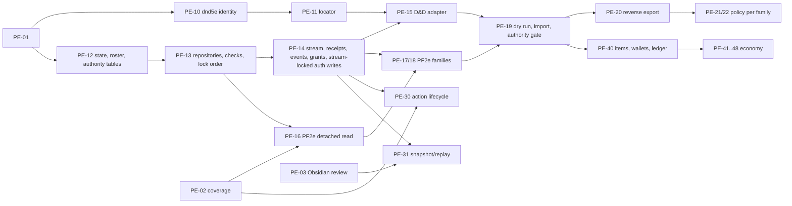

# Player release: state, command and authority contract (PE-01)

**Status:** proposed for Codex review.
**Base:** `origin/main` `d08085b0` (PR #243). Source anchors are symbols on that commit, linked
rather than copied.

**Rules for this document.**
- "Must" binds every later task.
- A task that needs a different rule revises this file and gets it reviewed again (task-map
  rule). It does not create a second protocol.

**Scope.** PF2e and D&D 2014/2024 state for the player release. Cosmere and Mistborn keep their
current paths and adopt this contract later; nothing here may break them. None of this is
implemented yet.

## 1. Identifiers and rules pins

| ID | Format | Source | Notes |
|---|---|---|---|
| `campaign_id` | `[0-9a-f]{32}` | existing stores | `core/request_context.py::CampaignContext` |
| `character_id` | existing: ≤ 64 chars `[A-Za-z0-9_-]`; new: 32-hex | SQL `characters.id` (`ownership.register_character` keeps `doc.id` when it is ≤ 64 chars) | D&D: equals the file `pid` (`store.py::pc_path`). PF2e/Cosmere: the SQL id; the filename is only the locator. Never a display name. The dry run reports nonconforming ids. |
| `item_id` | 32-hex (uuid4, globally unique) | server, on create/split/migration | D&D 12-hex `uid` is kept read-only as nullable `legacy_uid`; the D&D index keys `i{idx}` (`rules/character.py`, `routes.py`) are remapped. A PF2e stored entry gets one id each; same-name entries are never merged. Restore mints new ids. |
| `effect_id`, `encounter_id`, `combatant_id`, `action_id`, `prompt_id`, `event_id`, `advance_id` | 32-hex | server | D&D `cid` already matches the `combatant_id` format and is kept. PF2e/Obsidian `instance_id` becomes `legacy_ref`. `action_id` is server-minted; the row stores the initiating `operation_id`. |
| `session_id` | `[A-Za-z0-9._:-]{8,120}` | GM/Obsidian session start | Today `start_session` accepts any string ≤ 120. New commands validate the format, and the dry run reports nonconforming ids. |
| `operation_id` | `[A-Za-z0-9_-]{16,128}` | client, once per attempt (section 3) | The legacy Obsidian `command_id` (`COMMAND_ID_RE`) stays on the legacy route until PE-60. |
| `seq` | int64 > 0, contiguous per campaign | allocated under the stream lock | Replay cursor and order. **A seq is not a revision.** |
| `stream_epoch` | int ≥ 1, monotonic per campaign, never reset | `campaign_state_authority` row | Bumped whenever authority becomes `db` or `file` (including abort), on entering `exporting`, and on campaign-archive restore (PR4B). Not bumped on `file → migrating`. |

**Rules profile.** The campaign's pin lives in SQL `campaigns.settings.rules`
(`{profile, content}`). Characters and encounters copy it when created, and every command must
match it.

| `rules_profile` | Legacy value | `content` pin |
|---|---|---|
| `pf2e` | n/a | `{"ruleset_id", "manifest_sha256"}` (ADR-0003). Existing records use `pf2e-legacy-unknown` with `manifest_sha256: null` until PE-36. |
| `dnd5e-2014` | `edition: "classic"` | `{"data_version": <installed VERSION>, "db_sha256"}`. The data itself stays off Git. |
| `dnd5e-2024` | `edition: "one"` | same |

- **Content changes.** When the installed content stops matching a pin, commands that derive
  rules fail with `503 content_mismatch`; reads still work. The GM command
  `campaign.repin_content` revalidates every character, reports failures, and writes the new pin
  with an event. The admin data page lists the campaigns that need it.
- **D&D edition default.** A D&D campaign with no explicit edition defaults to `one` today
  (`systems/dnd5e/routes.py::edition`). The dry run reports it as `implicit_default` and the GM
  must confirm it.
- **Edition mismatch.** A character whose `build.edition` differs from the campaign gets
  `422 edition_mismatch` until an explicit conversion runs. A saved character is never
  reinterpreted under another edition.
- **System strings** are exactly `pf2e`, `dnd5e` and `cosmere`.
- **D&D locator (PE-10/11).**
  - `legacy_storage = "dnd5e_characters"` and `legacy_file = "<pid>.json"`, with
    `legacy_file == id + ".json"`.
  - The path must be exactly `campaigns/<cid>/dnd5e/characters/<pid>.json`.

## 2. State records, revisions and conflicts

| Record | Key | Contents | Revision |
|---|---|---|---|
| `character_states` domain `build` | `(campaign_id, character_id, 'build')` | Ancestry/species, class levels, choices, feats, spells known, ability method, name, public details and portrait. D&D `build` + `details` (`service.py::BUILD_KEYS`); PF2e Pathbuilder build minus equipment. | `build` rev; replaces D&D `build_rev` |
| `character_states` domain `play` | `(campaign_id, character_id, 'play')` | HP/temp HP, conditions, owned effects, death saves, resource/slot/focus/hero-point usage **plus reservations**, prepared spells, inspiration, owner-private notes | `play` rev |
| `item_instances` (PE-40) | `item_id` | Holder (`character`/`stash`/`shop`), container (`null` = the holder's top-level "root"), qty, equipped/invested/attuned, charges, revealed and unrevealed properties, notes, `lock`, `self_reported` | per item |
| `wallets` + `ledger_lines` (PE-40) | `(campaign_id, holder)` | Coin counts per system denomination (D&D cp/sp/ep/gp/pp, PF2e cp/sp/gp/pp), plus `held_cp` and `unconfirmed_cp`. Each balance change appends a ledger line in the same transaction. | per wallet |
| campaign clocks | `(campaign_id, clock)` for `world`, `downtime` | Value and revision | per clock |
| `encounter_states` | `(campaign_id, encounter_id)` | Status, round/turn, initiative order, creature vitals and effects, rules pins, clock anchors | encounter rev |
| `encounter_combatants` | `(campaign_id, encounter_id, combatant_id)` | `kind`, `character_id` (composite FK to `characters(campaign_id, id)`, so a PC cannot come from another campaign), creature ref | via encounter rev |

- **PC vitals live in one place.** The encounter never copies PC vitals; they stay in the PC's
  `play` row, as `service.py::_vitals_getter` does today. Damage to a PC therefore bumps that
  PC's `play` revision and leaves the encounter revision alone.
- **Derivation inputs.** Derived stats are computed from `build`, `play` and equipped items.
- **Drafts** stay in `character_drafts` / `CharacterWorkflowReceipt`
  (`core/persistence/models.py`). Saving a draft never bumps `build`. In db authority, *publish*
  is one command: it writes the `build` row, the command receipt and the events, then marks the
  draft published. In file authority the existing workflow receipt stays in use.

```json
{"campaign_id": "a1...", "character_id": "c7...", "domain": "play", "schema_version": 1,
 "revision": 21, "rules_profile": "dnd5e-2024", "content": {"data_version": "2026.10", "db_sha256": "9f..."},
 "payload": {"hp": 24, "temp_hp": 0, "conditions": {}, "slots_used": {"1": 1}, "reserved": {}, "effects": []}}
```

**Checks before a command applies.** A command lists the revisions it relies on in `expected`, as
`{kind, id, rev}` entries. Every command type names one **subject** record, and checks 4 and 5
apply to that record. The server checks, in this fixed order; the first failure answers:
1. the envelope is well formed (`400 bad_envelope`);
2. the receipt (section 3);
3. the caller's campaign-level role allows this command type (`403 not_permitted`);
4. the subject exists *and the caller may see it* (`404 not_found`, the same answer for hidden
   and missing records, so ids cannot be probed);
5. the subject is not terminal *for this command* (`409 already_finalized`). For
   `action.correct` the subject is the stage, and the stage counts as terminal once it has been
   corrected;
6. every `expected` entry still matches (`409 stale_revision`);
7. the pins match:
   - `409 rules_mismatch`: the request's `rules` differs from the campaign pin;
   - `503 content_mismatch`: the installed content differs from the pin;
   - `422 edition_mismatch`: the character's pin differs from the campaign's;
8. the rules and grants allow it (`422`), including `unlock_required`, `in_encounter` and
   `target_invalid` (used only for targets the caller can see).

`expected` is required for:
- build saves and publishes;
- whole-list replacements;
- economy finalizations (the request, stash item or project row);
- clock advances (the clock row);
- whole-action commands (section 5).

**Override.** The envelope field `"override": {"reason": "..."}` is accepted only from the GM
(or a token scoped for it), and is recorded on the event. It bypasses only adapter validations
marked overridable, such as `in_encounter` and a rules legality check. It never bypasses checks
1–7, authorization, or the economy invariants in section 9.

An input to a pending action instead expects `{kind: "prompt", id, status: "open"}`, so
simultaneous saves against one action do not conflict. Intent commands (damage, heal, a
condition, spending a resource) treat `expected` as optional; the server validates them against
current state under lock.

```json
{"ok": false, "code": "stale_revision", "operation_id": "op-...",
 "conflicts": [{"kind": "character.build", "id": "c7...", "expected": 4, "current": 5}],
 "current": {"...": "caller's projection of the conflicting rows"}}
```

**Schema versions.** A reader upgrades older payloads in code and writes the upgrade back only
within a command. An unknown newer version fails closed with `503 authority_unavailable`.

**Lock order.** Every command transaction takes its locks in this order:
1. the campaign stream row;
2. the encounter;
3. action rows;
4. `character_states` rows, in ascending `(character_id, domain)` order;
5. items, wallets, shop, stash and project rows, in ascending id order;
6. then it inserts the receipt and events.

The stream lock is held until commit and is never narrowed: `seq` allocation and the snapshot
watermark depend on it. In file authority today's order stays as it is: D&D takes the encounter
before the PC (`store.py` docstring), and PF2e takes `_pc_spell_lock` before `ENCOUNTER_LOCK`.

**Max-HP reconciliation** is an adapter hook. It runs in the same transaction as any build
publish, item change or effect change that moves effective max HP, and appears in the result as
`result.reconciliation[]`. Let `effmax` be the system's effective maximum
(`combat.py::effective_max` for D&D; PF2e includes drained).
- **At 0 HP, or dying, unconscious or dead:** HP stays 0.
- **Otherwise:** `hp' = clamp(hp + (effmax' - effmax), 1, effmax')`. Damage already taken stays
  counted whether the maximum rises or falls.
- **Temp HP** is unchanged.
- **Used resources and reservations** clamp to the new maximum. A pool the change removed is
  dropped and listed.
- **Effects** whose source is gone end, with an event.
- **Choices** that are no longer valid become `choice` prompts stored in `play` (`origin:
  reconciliation`). They never block the publish and are never silently removed.
- **Combatants:** publishing a build while the character is a combatant in an active encounter
  gets `422 in_encounter`. The GM may override.
- **Preview** returns exactly the list that the commit will apply.

## 3. Command envelopes

The request body (db authority) for every player, GM, tracker and Obsidian mutation:

```json
{"schema": 1, "operation_id": "op-3f9c2e7a1b5d4c60", "campaign_id": "a1...", "epoch": 1,
 "type": "character.play.apply_damage", "subject": {"character_id": "c7..."},
 "expected": [], "rules": {"profile": "dnd5e-2024"}, "payload": {"amount": 7, "damage_type": "fire"},
 "client": {"origin": "website", "app_version": "...", "sent_at": "..."}}
```

- **Principals.** The principal is taken from the authenticated request, never from the body.
  Db authority accepts only two kinds: `USER`, keyed by `user_id`, and `INTEGRATION_TOKEN`,
  keyed by `credential_id`. `LEGACY_*` and `PUBLISH_TOKEN` get `403 not_permitted`.
- **Digest.** SHA-256 over the canonical JSON of `schema, campaign_id, type, subject, expected,
  rules, payload`: sorted keys, no spaces, `ensure_ascii=False`, `allow_nan=False`, integral
  floats written as ints. This is the VTT `_canonical`/`command_digest` scheme at `00b334b4`.
  `operation_id` and `client` are not part of it.
- **Receipt.** Unique on `(campaign_id, principal_kind, principal_id, operation_id)`. It stores
  the digest, the status (`committed`/`rejected`), the code, the revisions written, the event ids
  and the seq range. It holds no response body. Receipts and events are kept for the life of the
  campaign, across epochs.
- **Retry rule.**
  - Any recorded final answer, committed or rejected, ends that `operation_id`.
  - Clients retry with the **same** id only when they received no answer (network loss or a 503).
  - One UI gesture is one `operation_id`: the control stays disabled until it is answered, so a
    double-click resends the same id.
  - A new gesture after an answer mints a new id.
  - Clients keep every unanswered operation until it resolves.
- **Epoch.** The envelope carries the stream epoch it was prepared under. A command whose epoch
  differs from the current one gets `409 resync_required` and writes nothing. This stops a retry
  from crossing an authority flip, where file authority kept no receipt. On an epoch change,
  clients drop unanswered operations, show them as "outcome unknown", and resync.

| Code | HTTP | Writes | Notes |
|---|---|---|---|
| (applied) | 200 `committed` / 202 `pending` | state + receipt + events | `pending` when an action is left open |
| (replay: same key, same digest) | recorded status | nothing | `replayed: true`, plus a fresh projection under current authorization. `403` with no body if access was lost. |
| `bad_envelope` | 400 | nothing | malformed `operation_id`, unknown `schema`/`type`, or campaign mismatch with the route |
| `operation_id_reused` | 409 | nothing | same key, different digest |
| `not_found` | 404 | receipt | |
| `already_finalized`, `stale_revision`, `rules_mismatch`, `item_locked`, `insufficient_funds`, `insufficient_stock`, `insufficient_quantity` | 409 | receipt | |
| `validation_failed`, `rule_violation`, `not_live`, `in_encounter`, `unlock_required`, `edition_mismatch`, `target_invalid` | 422 | receipt | |
| `not_permitted` | 403 | nothing | a retry re-evaluates |
| `resync_required` | 409 | nothing | cursors (section 6) |
| `migration_in_progress`, `authority_unavailable`, `content_mismatch`, `temporarily_unavailable` | 503 | nothing | a lock timeout or serialization failure is `temporarily_unavailable` |
| commit raised (outcome unknown) | 503 `temporarily_unavailable` | unknown | the client retries the same key; the receipt answers |
| unexpected exception before commit | 500 `server_error` | nothing | |

- **Refusal receipts.** A refusal rolls back. A second short transaction then takes the stream
  lock and re-checks the receipt key before inserting the refusal receipt. If a committed receipt
  already exists, the response is that replay, not the refusal. The refusal is sent only after
  its receipt commits.
- **Obsidian today.** Main's `process_command` replays by `command_id` without a digest check.
  PE-60 must add it.

```json
{"ok": true, "operation_id": "op-...", "status": "committed", "replayed": false,
 "revisions": {"character.play:c7...": 22}, "events": [{"event_id": "e4...", "seq": 1842}],
 "watermark": 1842, "result": {"...": "caller projection"}}
```

**Event row.** One row per consequence; a single command may write several.

```json
{"event_id": "e4...", "campaign_id": "a1...", "seq": 1842, "stream_epoch": 1,
 "type": "character.damaged", "occurred_at": "2026-11-08T20:14:03Z",
 "session_id": "session-2026-11-08-ab12cd34", "encounter_id": "en...", "operation_id": "op-...",
 "action_id": null, "causation_event_id": null, "origin": "website",
 "principal": {"kind": "user", "id": "u9..."}, "actor": {"combatant_id": "cb...", "character_id": null},
 "rules_profile": "dnd5e-2024", "subjects": [{"kind": "character", "id": "c7..."}],
 "changes": [{"kind": "character.play", "id": "c7...", "rev": 22, "path": "hp", "before": 31, "after": 24}],
 "dice": [], "explain": [{"text": "7 fire damage"}],
 "visibility": {"owner": "full", "editor": "full", "viewer": "full", "party": "full",
                "encounter_player": "full", "qm": "none", "gm_integration": "full"}}
```

- **Visibility** is fixed when the event commits and keys on the projections in section 6. For
  each projection it is `full`, `none`, or `redact:[classes]`. The classes are `exact_hp`,
  `secret_roll`, `unrevealed_effect`, `unrevealed_item` and `hidden_actor`. A projection that is
  not listed gets `none`; `gm` always gets `full`.
  - `owner`, `editor` and `viewer` apply only to principals holding that role on the event's
    subject character.
  - The sample is damage to a PC, which every player projection sees in full. Damage to a
    revealed enemy would carry `encounter_player: "redact:[exact_hp]"`.
  - A later reveal emits new events and never re-exposes old ones.
- **Owner-private notes never enter events.** A notes change records only
  `{"path": "notes", "changed": true}`. Item notes are not private: they travel with the item.
- **Command responses.** The `events[]`, `revisions`, `conflicts` and `current` fields of a
  response pass through the caller's projection, so a response never names a hidden record.

## 4. Transaction boundary

**One database transaction** (db authority only) does all of the following:
1. Lock the campaign stream and allocate a contiguous seq range.
2. Check the receipt.
3. Re-read, from SQL in this same transaction (never from a `flask.g` or request cache), every
   input to the authorization decision:
   - the user row (disabled, admin);
   - the campaign row (GM, trashed/archived status);
   - membership and assignments;
   - campaign grants;
   - the token record and its scope;
   - the live session.
4. Check the rules pin and the authority state.
5. Validate the rules and mutate every affected row: character states, encounter and
   combatants, action, items, wallets and ledger, shop, stash, project.
6. Insert the receipt and the events.
7. Commit.

The event table is both the permanent history and the outbox. Delivery cursors never delete
events.

- **After commit, outside the transaction:**
  - **Hub wake.** The in-process hub is woken with `(campaign_id, seq)`. This is only a hint: the
    hub also polls for `seq > last_delivered` for every subscribed campaign, so a lost wake delays
    delivery but never drops it.
  - **SSE fan-out.**
  - **Obsidian pulls** and the plugin's own vault writes.
  - Delivery is at least once. Consumers deduplicate by `event_id`.
- **Never inside a transaction:**
  - waiting for a person;
  - loading rules content;
  - file writes. A file write paired with a SQL write is never treated as atomic
    (`character_files.py::write_document`).
- **Authorization changes take the stream lock.** Every change to a campaign-scoped
  authorization input takes that campaign's stream lock. That covers:
  - the campaign's GM and its trashed/archived status;
  - membership and assignment;
  - grants (`quartermaster`, `level_unlock`, `retrain_grant`);
  - token issue, scope and revoke;
  - session start and end.
- **Strictness.** Grant and membership checks are therefore strict at commit. Account-level
  changes (disable, admin flag, password or session invalidation) take effect from the next
  transaction after they commit.

## 5. Pending actions (fixed invariants; PE-30 elaborates them per rules profile)

An action row holds:
- `action_id`, `operation_id`, `encounter_id`, the actor, `state` and `revision`;
- `targets[]`, each with state `pending | resolved | held | voided`;
- `prompts[]`, each `{prompt_id, kind: roll|choice|save|reaction|gm_ruling, target, responders, status, opened_seq}`;
- `reservations[]`, the stored rolls, and the committed stage results.

**Action states.**

| State | Meaning |
|---|---|
| `open` | At least one target is `pending` or `held`. |
| `completed` | Every target is `resolved` or `voided`. Changes afterwards only through `correct`. |
| `cancelled` | Reservations released; stages already committed keep their events. |

There is no persisted "resolving" state, and nothing times out. A `held` target (invalidated, or
waiting on a GM ruling) blocks only itself.

**Responders.** Who may answer a prompt:
- **The actor's own roll or choice prompts:** the actor's owner or editor.
- **A save:** the target PC's owner or editor.
- **A reaction:** the reacting character's owner or editor.
- **Anything for an NPC:** the GM.
- **The GM may answer any prompt.** That is recorded as `delegated`.

**Action commands.** Every principal below is checked at commit.

| Command | Principal | Expected / validation | Writes / event |
|---|---|---|---|
| `action.declare` | Actor's owner/editor while `live` (section 8); GM for any combatant | Legal targets, available costs (`used + reserved ≤ max`), rules pin | Action row. Costs spent or reserved at the adapter's `commit_point`. Digital rolls made and stored. Prompts opened. `action.declared` |
| `action.input` | The prompt's responders | Prompt still `open`; dice valid. Target revalidated: in the encounter, same campaign. A target that is no longer valid **commits as `held`**; it is not refused. | Input stored. A target becomes `resolved` only when every prompt that could modify it (including reaction windows) is closed. Its changes apply once. `action.stage_resolved` |
| `action.close_window` | GM | Action rev | Non-responders recorded as "no reaction". A save is never defaulted. |
| `action.cancel` | Declarer only before any stored roll has been shown to a non-GM and before any target resolved. GM any time. | Action rev | Reservations released; spent costs are not refunded. `action.cancelled` |
| `action.gm_resolve`, `action.void_target` | GM | Action rev; target `pending` or `held` | GM-entered outcome or ruling, or the target voided; the target's open prompts close as `void`. `action.gm_resolved` |
| `action.correct` | GM | Action rev; the stage has never been corrected (otherwise `already_finalized`); the inverse is valid against **current** state | New events listing each reversed delta. Refused with `rule_violation` when intervening changes make the inverse unsafe; the GM then adjusts manually. |

- **Dice.** Every roll is stored as
  `{"source": "digital|physical", "entered_by", "expr": "1d20+7", "dice": [{"sides": 20, "value": 14}], "total": 21, "total_only": false}`.
  - **Digital rolls** use the server CSPRNG once, at commit. A retry returns the stored roll.
    Nothing is ever rerolled.
  - **Physical rolls** must supply the raw dice whenever natural values or die selection matter:
    every d20 in either system, advantage/disadvantage, crit dice. The count and range are
    validated. `total_only` is accepted only where the adapter declares naturals irrelevant.
  - **Missing input** keeps the prompt open.
- **Costs.**
  - Every write to a resource pool, including rests, publishes and intent commands, keeps
    `used + reserved ≤ max`. A write that would break this is refused with `rule_violation`.
    Only the revalidation of an action target (`action.input`) puts a target in `held` instead.
  - A spent cost is refunded only through `correct`.
  - Closing an encounter must first cancel or GM-resolve its open actions, in the same
    transaction.
- **Unsupported content** (`manual` in PE-02) declares a single `gm_ruling` prompt. The GM
  applies the outcome with manual-adjustment commands:
  - `character.play.adjust`: GM any field through adapter validation; owner/editor only the
    permitted own conditions.
  - `encounter.creature.adjust`: GM only.
  - `wallet.gm_adjust` and `item.gm_grant`: GM only.

  Clients and the plugin never compute outcomes; there is no second rules engine.
- **Clocks.** There are three explicit clocks: encounter round/turn, campaign world minutes, and
  campaign downtime days. The GM advances them. A disconnect never does.
- **Effects** are stored as
  `{effect_id, source, applier, target, rules_key, value, stacking_key, duration: {basis, anchor, remaining}, visibility, action_id}`.
  An effect expires inside the command that advances its clock.

## 6. Snapshot, replay and projections

- **Snapshot.** A single read-only `REPEATABLE READ` transaction returns
  `{campaign_id, stream_epoch, watermark: seq, projection_version, revisions, state}`.
- **Cursors** have the form `<campaign_id>.<epoch>.<seq>`.
  - The server rejects a cursor whose campaign is not the request's campaign.
  - Clients bind a cursor to website origin, campaign, principal and projection. A response that
    arrives after a switch must not advance the new context's cursor (PE-31 item 5).
  - A wrong epoch, a seq ahead of the stream, or a `projection_version` mismatch returns
    `409 resync_required`.
- **Replay** returns events after the cursor in order, at most 200 per page, projected for the
  current principal. Events the principal cannot see are skipped, but `next_cursor` still
  advances.
  - **Accepted limitation:** the gaps reveal that something happened at that point, though not
    what. This is recorded for remote play.
- **Live bridge.**
  1. Register the listener.
  2. Replay from the database after the cursor.
  3. Deliver buffered frames above the last replayed seq.

  Duplicates are allowed; gaps are not. SSE `id` equals the cursor. The legacy in-memory ring
  stays for legacy frames until PE-31b.
- **Obsidian** (choices made after reading
  [the companion audit](existing-obsidian-vtt-work.md); PE-03 may refine the port details). The
  legacy `events.jsonl` integer cursor keeps working on the legacy endpoint.
  PE-60 moves the plugin to the new cursor and keeps the v0.9 event-id deduplication. Legacy
  jsonl history is kept as an archive and is not imported. Room launch (PE-61) binds the preview
  digest and the encounter revision in `expected`.
- **Authorization** is checked again on the snapshot, on every replay page, and before every
  delivery batch. A grant or membership change closes the affected subscriptions before any
  further frame.

**Projections.** Each player-facing projection is computed for its own audience, never from a
cached GM payload.

| Projection | Contents |
|---|---|
| `gm` | Everything |
| `gm_integration` | `gm` minus owner-private notes; used for the Obsidian mirror |
| `owner` | Full own state including notes; items show revealed properties only |
| `editor` | `owner` minus notes |
| `viewer` | Sheet and derived stats; no notes, no unrevealed properties |
| `party` | Party HP and conditions |
| `encounter_player` | Initiative; revealed enemies' names, rough health and revealed effects; nothing hidden by the redaction classes |
| `qm` | Stash items, stash requests, pool wallet |

## 7. Authority, migration and rollback

**Scope.** Authority is per campaign. It covers **all** of the campaign's character, encounter,
action, item, wallet, economy and event state, and is held in
`campaign_state_authority(campaign_id, authority, stream_epoch, changed_at, source_checksum)`.

**Settings.** `STATE_BACKEND=file|shadow|db` (ADR-0002) controls the deployment:
- `file`: no db authority anywhere;
- `shadow`: read-only comparison, with no dual writes (PR4B rule);
- `db`: lets campaigns flip.

An unknown value is a startup error. Mixed authority inside one campaign is not allowed.

| From → To | Preconditions | Effect |
|---|---|---|
| `file` → `migrating` | `OWNERSHIP_BACKEND=sql`; every character has a SQL identity (D&D after PE-11/15); no pending publications; every mutation route for the system goes through the command layer (AST inventory test, like `tests/test_pc_save_reload_race.py`). Then take the campaign's **migration gate** exclusively: file-authority writers hold it shared for their whole read-modify-write, so the step waits for in-flight writers. Flip the state, then flush PF2e dirty state (`_flush_pending_persistence`), then snapshot. | The campaign's writes return `503 migration_in_progress` |
| `migrating` → `db` | Clean dry-run report, or one explicitly accepted; import; verify counts and checksums; no unresolved identity | db authoritative; `stream_epoch += 1` |
| `migrating` → `file` | Abort | Only this attempt's state rows are deleted. Receipts, events and the authority row are kept; `stream_epoch += 1` |
| `db` → `exporting` | GM/admin tool, under the stream lock. **Refused** while any db-only record is non-terminal: actions, prompts, transfers, purchase requests, crafting projects, loot requests or unconfirmed self-reports. Nothing is force-cancelled. | Writes return `503 migration_in_progress`; `stream_epoch += 1` |
| `exporting` → `file` | Reverse-export **current** state to a new directory, including `item_id` and `effect_id`; verify; swap | Files authoritative; `stream_epoch += 1`. db character/encounter rows are kept and marked stale. db-only tables (ledger, shops, stash, history, terminal economy records) stay untouched, and a later import keeps them and **replaces only** the state rows. |
| `exporting` → `db` | Abort | No change to db rows; `stream_epoch += 1` |

- **No silent fallback.** In db authority a missing row is an error and files are never read. In
  file authority the new tables are ignored.
- **File authority limits.**
  - What it keeps: today's per-file locks, D&D `build_rev`, and a PF2e `content_checksum` build
    precondition (PE-16).
  - Authorization is checked once per request, from SQL, at request start. It is not taken under
    the stream lock.
  - There is no cross-document atomicity, and no exactly-once guarantee.
  - **Db authority only:** pending actions, multi-target resolution, purchases, transfers, loot
    finalization, crafting downtime, all-origin history, and snapshot/replay activation.
  - Anytime reads and edits of converted operation families (PE-21/22) may run in file
    authority.
- **Dry-run report.**
  - Counts and checksums for characters, owners, drafts, HP/resources, effects, gear and active
    encounters.
  - Minted ids, with same-name entries kept separate.
  - Unresolved container references.
  - Nonconforming ids.
  - Edition mismatches and implicit defaults.
  - PF2e `investment_unknown`. Today the invested flag lives only in the browser, so after
    migration the player confirms it once with `inventory.confirm_investment`, validated against
    the limit and never guessed.
- **PF2e constraints.**
  - In db authority, `PARTY_LIBRARY` and the encounter globals are caches rebuilt from committed
    rows for the live campaign. They are never the authority.
  - The debounced flush is off for db campaigns.
  - Name-keyed legacy routes resolve a name to an id only within the addressed campaign, through
    the locator, and refuse any ambiguity.
  - Taking the PF2e slot from a campaign with a live session first ends that session, by command.
- **Single worker.** The deployment stays on one worker until all of the following are replaced:
  - the PF2e globals and the live slot;
  - the in-memory SSE subscribers and replay ring;
  - the `threading` locks in `systems/dnd5e/store.py` and `core/obsidian_sync.py`;
  - the migration gate;
  - the debounced flush.

  PE-14 must test that two greenlets contending for the stream lock do not stall the worker
  (psycopg). Concurrency acceptance runs on PostgreSQL; SQLite lacks `FOR UPDATE` and
  `REPEATABLE READ`.
- **Private content.** Test fixtures are synthetic. The installed D&D data and Mistborn data stay
  off Git; pins store only versions and hashes.
- **Populated downgrade (PE-12).** Refused while any campaign is `db` or `migrating`, or while
  state rows exist without a verified reverse export (`migration_runs` status `exported`) newer
  than their last write.

## 8. Permission matrix

**Terms.**
- **Live** means the campaign has an active SQL session record (started and ended by command) and
  the character is a combatant in that campaign's active encounter. The process-global slot is
  not part of the definition.
- **any:** regardless of which campaign is live.
- **Roles** come from `character_assignments`. **Party** means a player member with no assignment
  to that character. **GM** includes the site admin.
- **QM** is a campaign grant row `(campaign_id, user_id, 'quartermaster')`.
- **Token** is an Obsidian integration token whose command scope the GM chooses at mint. It may
  include approvals, unlocks, downtime and loot finalization (PE-62). It can never manage
  membership, ownership, tokens or QM grants, and it never sees owner-private notes. Tokens that
  exist today get only the current live-command set.

| Action | Owner | Editor | Viewer | Party | QM | GM | Token |
|---|---|---|---|---|---|---|---|
| View sheet | `owner` | `editor` | `viewer` | `party` | `party` | `gm` | `gm_integration` |
| Owner-private notes | read/write | – | – | – | – | read/write | – |
| Save draft / incomplete build | any | any | – | – | – | Y | – |
| Publish level-up | any, with an unconsumed `level_unlock` for the target level (consumed on publish) | same | – | – | – | Y | if scoped |
| Issue `level_unlock` / `retrain_grant` | – | – | – | – | – | Y | if scoped |
| Retrain/respec publish | needs `retrain_grant` scoped to the current published build rev (consumed) | same | – | – | – | Y | – |
| Prepare, rest | any, but not while a combatant in an active encounter (`in_encounter`) | same | – | – | – | Y | Y |
| Own permitted conditions (add/adjust/remove) | any | any | – | – | – | Y | Y |
| Combat actions; answering own prompts | live | live | – | – | – | Y | Y |
| Move/equip/invest/attune/consume/split/notes on own unlocked items | any | any | – | – | – | Y | – |
| `inventory.self_report` (add an item, adjust coin) | any | any | – | – | – | Y | – |
| `item.gm_grant`, `wallet.gm_adjust`, identify item | – | – | – | – | – | Y | if scoped |
| Offer a transfer / accept an incoming one | any | any | – | – | – | Y | – |
| Purchase request / accept a changed quote | any | any | – | – | – | Y | – |
| Quote, approve or reject a purchase; shop stock and pricing | – | – | – | – | – | Y | if scoped |
| Crafting: create or edit (`planned` only), start, pause, cancel | any | any | – | – | – | Y | – |
| Advance downtime or the world clock | – | – | – | – | – | Y | if scoped |
| Loot: request/withdraw for own characters; deposit own item | any | any | – | – | – | Y | – |
| Loot finalize; pool split; GM deposit/award | – | – | – | – | Y | Y | if scoped |
| Hidden encounter data, rules override, corrections | – | – | – | – | – | Y | if scoped |

- **Fresh authorization at commit** (section 4) applies to every row.
- **QM limits.** The grant gives nothing beyond its row: no character edits, no shop approval,
  no hidden data, no rules override.
- **Self-reported entries.** `self_report` keeps today's ability to record gear and coin received
  at the table: D&D `inventory_action('add')` and `set_currency`, PF2e `/api/add_item`.
  - Every entry is flagged `self_reported`, writes a ledger line, and emits an event the GM sees.
  - The GM can reverse it.
  - It never counts as purchase fulfillment.
  - Self-reported coin is added to `unconfirmed_cp`, and self-reported items cannot be sold,
    transferred or deposited until the GM confirms them (`wallet.gm_adjust` / `item.gm_grant`,
    which can confirm in batches).
  - So self-reports cannot mint value into the shared economy. This is a contract decision for
    review; see the report.
- **Campaign switching.** Opening a non-live campaign never calls `load_campaign` and never
  changes the slot.
- **Replacing `capabilities_for`.** This matrix replaces
  `core/character_workflows/capabilities.py::capabilities_for` only for routes already detached
  from live caches (PE-21/22). D&D joins after its route integration (PE-11/PE-15), not merely
  after its schema (PE-10).

## 9. Economy state machines

**Shared rules.**
- **Funds.** Available funds = wallet value in cp − `held_cp` − `unconfirmed_cp`. Every write keeps
  `value ≥ held_cp + unconfirmed_cp` and both terms ≥ 0, GM adjustments included.
- **Paying.** The adapter's `pay(wallet, cost_cp)` makes change deterministically.
- **Ledger.** Every balance change appends `{ledger_id, holder, delta, reason, operation_id}`.
- **Items** have exactly one holder. A **locked** item, or anything inside a locked container,
  cannot be spent, equipped, invested, sold, moved or offered.
- **No cross-campaign transfers.**

**Purchase** (`submitted → quoted? → fulfilled | rejected | cancelled`). Nothing is reserved
before fulfillment.

| Transition | Who | Atomic writes |
|---|---|---|
| submit `{character_id, shop_id or catalog, item_ref, qty, max_unit_cp}` | Owner/editor of the buyer | Request row, rev 1; `purchase.requested` |
| approve, with an exact quote within the request's terms | GM | **Fulfillment:** recheck available funds and stock; pay from the buyer's wallet; decrement limited stock; mint the items; request becomes `fulfilled` |
| quote with changed terms | GM | Request becomes `quoted`; `quote_rev += 1`; every quote is kept in history |
| accept_quote (expected `quote_rev`) | Buyer's owner/editor | Same fulfillment writes |
| reject / cancel | GM / requester | Terminal; nothing moves |

**Transfer** (`offered → accepted | declined | cancelled | voided`).
- **Offer.** A partial quantity is split off first into a new `item_id`, which is the item
  locked. A container's contents are locked with it. Currency is added to the sender's
  `held_cp`.
- **Accept** (the recipient's owner/editor), in one transaction:
  - **Items:** change the holder to the recipient's root and release the lock. Equipped, invested
    and attuned are cleared; identification, charges, runes and notes are kept.
  - **Currency:** `held_cp -= amount`; debit the sender with `pay`; credit the recipient; write
    both ledger lines.
- **Decline, cancel or void** (decline by the recipient, cancel by the sender, void by the GM or
  when the item is gone): release the lock or hold. Nothing else changes.

**Crafting project** (`planned → active ⇄ paused → completed | failed | cancelled`).
- **Planned.** Editable by its owner/editor. Nothing is reserved yet.
- **Start** (owner/editor). The adapter validates the recipe and prerequisites. Then the material
  items are **locked** (`lock: project`) and the project's whole coin cost is added to the
  crafter's `held_cp`. Nothing is consumed yet.
- **Downtime advance** — `downtime.advance {days}` (GM; expects the `downtime` clock revision;
  `advance_id` is minted by the server from the command):
  - The campaign clock moves by the given days.
  - Each `active` project with no open prompt gets progress exactly once, enforced by a unique
    `(project_id, advance_id)` row.
  - A project skipped because of an open prompt is listed in the event.
  - A required check opens a roll prompt. An unsupported recipe opens a `gm_ruling` prompt.
- **Completion.** When progress reaches the target, or on a GM ruling, one transaction consumes
  the locked materials and the held coin and grants the output item. Funds are already held, so
  completion cannot fail for lack of money.
- **Cancel or fail.** Release the locks and holds. The adapter names any forfeited portion; that
  portion is consumed in the same transaction and recorded in the ledger.

**Shared loot.**
- **Holder.** Stash items have holder `stash`.
- **Deposits.** The GM can award items into the stash, and closing an encounter can move loot
  into it. A player can deposit their own unlocked item.
- **Requests.** A request `{item_id, qty, character_id}` (`requested`; the requester may withdraw
  it, making it `withdrawn`) never moves the item and never adds it to usable inventory. Many
  requests can name the same item.
- **Finalize** (GM/QM; expected stash-item rev):
  - Lock the item and check the remaining quantity.
  - Move or split it to the chosen recipients. A split part gets a new `item_id`.
  - The chosen requests become `awarded`. The others stay `requested` while quantity remains, and
    become `declined` once none does.
- **Pool split.** A split of the pool wallet cannot exceed the pool's available funds.

## 10. Worked examples

1. **Campaign A edited while B is live.**
   - **Setup.** Campaign B (PF2e) holds the slot and a live session.
   - **D&D in A.** Ana opens her D&D character in A at `/campaigns/A/...`. The context is
     `campaign_id=A, live_campaign_id=B`. Draft saves and inventory moves are allowed (**any**).
     `action.declare` gets `422 not_live`. Events go only to A's stream, and B's globals are
     untouched.
   - **Removal.** The GM removes Ana's assignment, which takes A's stream lock. Her next
     db-authority save is checked at commit and gets `403`.
   - **PF2e in A.** Bo opens a PF2e character in A. PE-16's detached adapter reads A's files (or
     rows), never `PARTY_LIBRARY`. In file authority his authorization is checked per request,
     from SQL.
2. **Concurrent build save and damage** (D&D 2024, Ana between fights).
   - **Starting state.** `build` rev 4; `play` rev 20, HP 31/38.
   - **Damage.** The GM applies 7 damage: `play` rev 21, HP 24.
   - **Publish.** Ana publishes a level-up with an unconsumed unlock for level 5, expecting
     `build` rev 4. Result: `build` rev 5, effective max 45, HP 24 + 7 = 31, `play` rev 22.
     Events: `character.build_published`, `character.build_reconciled`.
   - **Second tab.** Another tab, still expecting `build` rev 4, gets `409 stale_revision`.
   - **Outcome.** The damage is never lost, and the damage command never needed the build
     revision.
3. **Duplicate purchase approval.**
   - **Request.** Request R is `submitted` at rev 1: Bo asks for a potion at no more than 50 gp.
   - **Double click.** The GM's double-click is one gesture, so `op-A` is sent twice. The first approval commits: pays
     5000 cp, mints one item, and R becomes `fulfilled` at rev 2. The retry replays and writes
     nothing.
   - **Concurrent approval.** The Obsidian pane approves at the same time with `op-B`. The stream
     lock serializes it behind `op-A`. The terminal check runs before the revision check, so it
     gets a receipted `409 already_finalized`. No money moves.
4. **Conflicting loot requests.**
   - **Setup.** The stash holds a +1 longsword L (qty 1, rev 3). Ana and Bo both request it; the
     stash does not change.
   - **Race.** The QM finalizes L to Ana while the GM finalizes L to Bo. Both commands have L as
     their subject and expect L rev 3.
   - **Winner.** The first wins: L moves to Ana at rev 4. Her request becomes `awarded` and Bo's
     `declined`.
   - **Loser.** The second command's subject L still exists and is not terminal, so check 6 fails:
     `409 stale_revision`. L never reaches two characters.
5. **Interrupted multi-target action** (PF2e, basic Reflex).
   - **Declare.** The caster targets Ana, goblin G1 and goblin G2. The slot is spent at
     `declare` (assuming PE-30 sets that `commit_point` for spell slots) and the damage rolled and
     stored. Three save prompts open: Ana's owner, and the GM
     for each goblin.
   - **G1.** The GM enters G1's physical d20 as `[14]`. G1 resolves, and its damage applies once.
   - **Restart.** The server restarts. The action and its prompts are durable.
   - **G2.** A GM command removes G2 from the encounter. The GM's later input for G2 commits G2
     as `held`. The GM voids it, which closes its prompt as `void`.
   - **Ana.** She reconnects and submits `[17]` against her open prompt. The response is lost, so
     she retries with the same id. The replay returns the stored result, and the damage was
     applied once.
   - **End.** The action is `completed`. Its history shows the declare, two resolutions and one
     void, linked by `action_id`.

## 11. Dependencies and follow-up split



| Task | Owns from this contract |
|---|---|
| PE-10 / PE-11 | Section 1 system, storage discriminator, path and refusal rules |
| PE-12 | `character_states` (`build`, `play`), `encounter_states`, `encounter_combatants` (composite FK), campaign clocks, `campaign_state_authority`, pins, revisions; the `exported` status on the existing `migration_runs`; the populated-downgrade rule; one active encounter per campaign as a partial unique index (`sqlite_where`/`postgresql_where`, as `uq_character_assignments_one_owner` does). State rows cascade with their character; events keep their ids and have no FK. |
| PE-13 | Check order, conflict body, lock order, reconciliation hook (section 2). Repository-only invariant: the character's profile equals the campaign's. |
| PE-14 | `campaign_streams`, `command_receipts`, `game_events`, `campaign_grants`, token scope; digest, code table, transaction steps, stream-locked authorization writes, greenlet contention test (sections 3, 4) |
| PE-15 / PE-16-18 | Domain mapping, file-authority limits, PF2e constraints (sections 2, 7) |
| PE-19 / PE-20 | Authority transitions, migration gate, dry-run report, rollback (section 7) |
| PE-21 / PE-22 | Permission matrix per converted family (section 8) |
| PE-30 → PE-32/33/34 | Action and effect tables and lifecycle (section 5); PE-30 briefs the table owner |
| PE-31 / PE-60 / PE-61 | Section 6 cursors and projections; plugin digest and cursor migration; preview binding |
| PE-40 | `item_instances`, `wallets`, `ledger_lines`, locks, id backfill. PE-41: containers/investment. PE-42: transfers. PE-43/44: shops and purchases. PE-45/46: projects and downtime. PE-47/48: stash, requests, QM. |

**Not decided here, by design:**
- each feature's `commit_point` and support level (PE-02/PE-30);
- each family's event type names (registered by the task that implements it, under section 3);
- UI wording (PE-07).
